# Justice or Prejudice? — Étude de reproductibilité

Présentation de 20 diapositives (15 à 20 minutes). Chaque diapositive comporte trois parties :

- **Texte** : ce qui apparaît sur la diapositive ;
- **Visuels** : figure, tableau ou diagramme à afficher ;
- **Discours** : ce que vous dites à l'oral (non affiché).

Les figures en français sont dans `analysis/fr/` (générées par `python analysis/figures_fr.py` à partir des CSV de `analysis/`). Les valeurs « article » viennent des tableaux 4, 5, 7 et 8 de Ye et al. (ICLR 2025).

Abréviations utilisées partout : **RR** = taux de robustesse, **CR** = taux de cohérence, **BIS** = CR − RR, **AIR** = taux d'amélioration de la précision, **Err_RA** / **Err_SE** = taux d'erreur des biais de raffinement et de self-enhancement.

---

## Diapositive 1 — Titre

### Texte
**Justice or Prejudice? Quantifying Biases in LLM-as-a-Judge**
Étude de reproductibilité de Ye et al. (ICLR 2025)

[Groupe 4, Module MIR] — [Encadré par Dr. Liana Ermakova] — [ENIB]

### Visuels
Aucun (éventuellement le logo de l'établissement).

### Discours
Bonjour à toutes et à tous. Je vais vous présenter mon étude de reproductibilité de l'article « Justice or Prejudice? », publié à ICLR 2025 par Ye et ses co-auteurs. Cet article s'intéresse aux biais des grands modèles de langage lorsqu'on les utilise comme juges, c'est-à-dire pour évaluer ou comparer des réponses à la place d'annotateurs humains. L'objectif de mon travail était double : d'abord vérifier si les résultats publiés peuvent être retrouvés en suivant le protocole décrit, ensuite examiner d'un œil critique le protocole et le benchmark eux-mêmes. Je vais donc vous montrer ce que nous avons pu reproduire, ce qui ne l'a pas été, et surtout pourquoi.

---

## Diapositive 2 — Plan

### Texte
1. Contexte : LLM-as-a-Judge et le cadre CALM
2. Questions de recherche
3. Mise en œuvre : code, modèles, infrastructure, difficultés
4. Écarts au protocole
5. Résultats : stabilité, robustesse, biais par biais
6. Reproductibilité avec des modèles récents
7. Limites et erreurs du benchmark
8. Conclusion et perspectives

### Visuels
Liste numérotée ; éventuellement une barre de progression reprise en haut des diapositives suivantes.

### Discours
Voici le déroulé. Je commence par rappeler ce qu'est l'approche LLM-as-a-Judge et le cadre CALM proposé par les auteurs. Je présente ensuite les cinq questions de recherche qui structurent l'étude. Puis je décris notre mise en œuvre : le code, les modèles choisis, l'infrastructure matérielle et les difficultés rencontrées, ainsi que les écarts au protocole qui en découlent. Vient ensuite le cœur de l'exposé : la stabilité des jugements, puis les résultats biais par biais, comparés à ceux de l'article. Je termine par les limites et les erreurs que nous avons relevées dans le benchmark, avant de conclure et d'ouvrir sur les perspectives.

---

## Diapositive 3 — Contexte et cadre CALM

### Texte
- **LLM-as-a-Judge** : un LLM compare deux réponses (choix A/B) ou note une réponse (1–10).
- **L'article** : 12 biais, 6 juges (ChatGPT, GPT-4-Turbo, GPT-4o, GLM-4, Claude-3.5, Qwen2-72B), température 0,7.
- **3 jeux de données** : alignement (439 paires DPO), faits (500 : GSM8K, MATH, ScienceQA), raffinement (500 annoncés : CommonsenseQA, Quora-QuAD, TruthfulQA).
- **Principe « attack-and-detect »** : on perturbe la réponse ou l'instruction, puis on compare les jugements avant et après.
- **Métriques** : RR = part des jugements inchangés après perturbation ; CR = part des jugements inchangés en répétant à l'identique ; AIR (CoT) ; Err_RA et Err_SE (notation).

### Visuels
Diagramme du protocole :

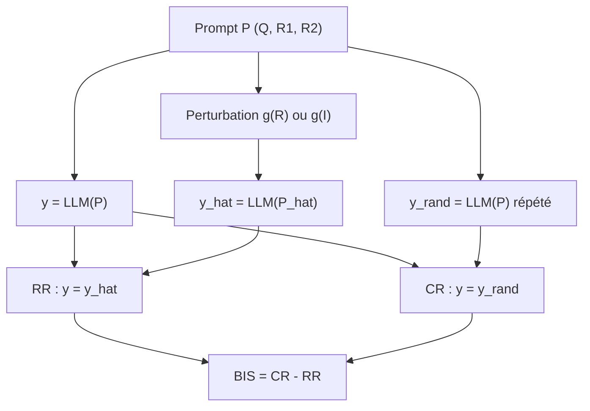

### Discours
L'approche LLM-as-a-Judge consiste à demander à un modèle de choisir la meilleure de deux réponses, ou de noter une réponse sur dix. Elle est très utilisée dans les benchmarks et pour l'entraînement par récompense, d'où l'importance de ses biais. L'article identifie douze biais et propose le cadre CALM pour les mesurer automatiquement. Le principe est simple : on obtient un premier jugement y, puis on applique une perturbation, par exemple une fausse citation ou une réponse rallongée, et on obtient ŷ. Le taux de robustesse, RR, est la part des cas où le jugement ne change pas. En parallèle, on répète le jugement sans aucune perturbation : c'est le taux de cohérence, CR, qui mesure le bruit du juge. L'écart entre les deux, le BIS, défini en annexe de l'article, isole l'effet propre du biais. Nous nous appuierons beaucoup sur ce BIS.

---

## Diapositive 4 — Les 5 questions de recherche

### Texte
| # | Question | Statut |
|---|---|---|
| 1 | Reproduire avec les mêmes modèles et les mêmes données ? | Impossible : mêmes données, autres modèles |
| 2 | Les jugements répétés sont-ils assez stables pour interpréter les écarts comme des biais ? | Traitée (CR) |
| 3 | Les résultats tiennent-ils avec des modèles plus récents ? | Traitée |
| 4 | Et sur d'autres jeux de données de l'état de l'art ? | Travaux futurs |
| 5 | Le benchmark a-t-il des limites ou des erreurs ? Résultats sur un benchmark corrigé ? | Limites traitées ; benchmark corrigé en perspective |

### Visuels
Le tableau ci-dessus, avec un code couleur pour le statut (vert : traitée, orange : partielle, gris : future).

### Discours
Notre encadrante nous a confié cinq questions. La première : peut-on reproduire les résultats avec les mêmes modèles et les mêmes données ? Nous avons gardé les données, mais pas les modèles, pour des raisons que je détaille juste après. La deuxième porte sur la stabilité : si un juge change d'avis sans aucune perturbation, on ne peut pas attribuer un changement à un biais. Nous l'avons mesurée avec le taux de cohérence. La troisième, centrale, demande si les conclusions tiennent avec des modèles plus récents. La quatrième, sur d'autres jeux de données, relève des travaux futurs. Enfin, la cinquième porte sur la qualité du benchmark lui-même : les données illustrent-elles vraiment chaque biais, et la construction introduit-elle ses propres biais ? Nous verrons que oui, à plusieurs endroits.

---

## Diapositive 5 — Notre implémentation

### Texte
- **`judge.py`** : prompts du dépôt officiel, jeu de données original, température 0,7.
- **Interface en ligne de commande** : modèle, biais, température, `--limit`, `--host`, `--cr-fraction`.
  `python judge.py qwen3:4b position --host <ip>:11434`
- **Résultats bruts en JSON** : options, modèle, biais, sorties avec et sans biais, réponse brute. L'article, lui, ne publie que des métriques agrégées.
- **Reprise sur interruption** : sauvegarde après chaque appel, reprise sans refaire les appels réussis.
- **`analyze.py`** : RR, CR (intervalle de Wilson à 95 %), précision, AIR, Err_RA, Err_SE, figures.
- **Jeu d'alignement** : jusqu'aux 439 questions pour bandwagon, diversity et self-enhancement (l'article se limite à 150).

### Visuels
Schéma du flux de données :

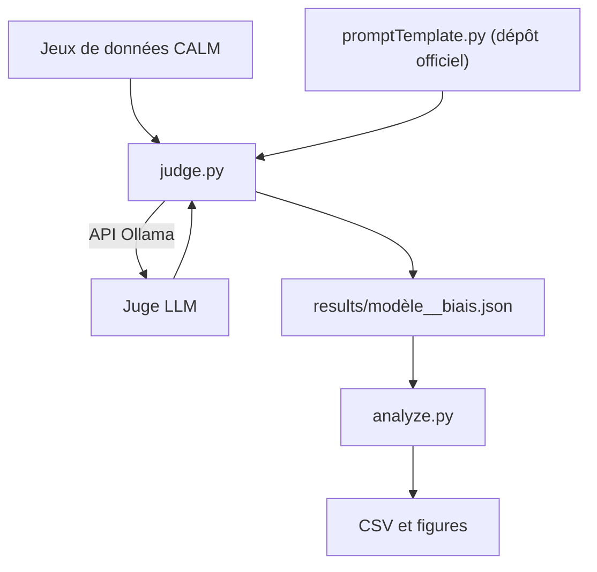

### Discours
Concrètement, j'ai écrit un script, judge.py, qui respecte le cadre CALM : il reprend les prompts du dépôt officiel des auteurs, leur jeu de données et leur température de 0,7. Une même interface en ligne de commande permet de choisir le modèle, le biais, la température ou le nombre d'items, ce qui garantit des conditions identiques d'une exécution à l'autre. Point important pour la reproductibilité : chaque jugement est sauvegardé en JSON avec ses options, la sortie du modèle avec et sans biais, et la réponse brute. L'article, lui, ne publie que des métriques agrégées, ce qui empêche toute vérification. Le script reprend aussi automatiquement après une interruption. Un second script, analyze.py, calcule ensuite les mêmes métriques que l'article, avec en plus des intervalles de confiance pour le taux de cohérence. Enfin, pour trois biais, nous utilisons davantage de questions que l'article.

---

## Diapositive 6 — Modèles et infrastructure

### Texte
- **Juges** : Qwen3 4B, DeepSeek-R1 7B, Gemma4 e4B (open source, récents, légers).
- **Matériel** : 2 cartes NVIDIA Jetson Orin Nano, modèles servis par **Ollama**.
- **Script** exécuté sur le PC, appels réseau vers les cartes.
- **Réseau** : point d'accès mobile ; `ip-finder.js` balaie le sous-réseau (port 11434) pour trouver l'adresse des cartes.

### Visuels
Diagramme d'architecture :

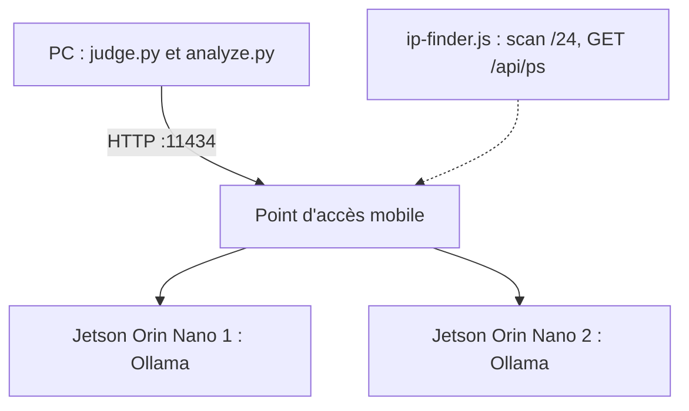

Option : photo des deux cartes.

### Discours
Pour les juges, nous avons choisi trois modèles open source récents et légers : Qwen3 en 4 milliards de paramètres, DeepSeek-R1 en 7 milliards et Gemma4 en version e4B. Ils tournent localement sur deux cartes NVIDIA Jetson Orin Nano, servis par Ollama. Le script s'exécute sur mon PC et envoie les requêtes aux cartes par le réseau. Comme les cartes obtiennent une adresse dynamique sur le point d'accès, j'ai écrit un petit script, ip-finder, qui interroge chaque adresse du sous-réseau sur le port d'Ollama et affiche celles qui répondent. Ce choix a un prix évident : nos juges sont dix à vingt fois plus petits que Qwen2-72B, le seul juge open source de l'article, et sans doute bien plus petits encore que les modèles propriétaires. Il faudra en tenir compte dans l'interprétation.

---

## Diapositive 7 — Difficultés et solutions

### Texte
| Difficulté | Solution |
|---|---|
| Modèles de l'article retirés (remplacés par des versions plus récentes) ou trop coûteux : environ 21 M de tokens d'entrée et de sortie par modèle | Modèles open source légers, exécutés localement sur 2 Jetson Orin Nano |
| Cartes configurées pour un routeur local : impossible de télécharger les modèles ; eduroam trop lent | Point d'accès mobile et `ip-finder.js` ; environ 55 Go de données consommées pour les deux cartes |
| Exécutions très longues : plus de 8 h pour le biais le plus court | Sortie limitée à 256 tokens et consigne de concision dans chaque prompt : **77 % de temps gagné** en moyenne |

### Visuels
Le tableau ; éventuellement une icône par ligne (coût, réseau, temps).

### Discours
Trois difficultés pratiques ont façonné l'étude. D'abord les modèles : plusieurs juges de l'article ne sont plus disponibles dans leur version d'origine, et les autres auraient coûté cher, avec environ vingt et un millions de tokens par modèle. D'où le choix de modèles locaux. Ensuite le réseau : les cartes étaient configurées pour un routeur local, ce qui empêchait de télécharger les modèles, et eduroam était trop lent. Nous sommes passés par un point d'accès mobile, pour environ cinquante-cinq gigaoctets de données au total. Enfin le temps de calcul : même le biais le plus court dépassait huit heures. Nous avons donc limité la sortie à deux cent cinquante-six tokens et ajouté une consigne de concision à chaque prompt, ce qui a réduit le temps d'exécution de soixante-dix-sept pour cent en moyenne. Ces solutions ont des conséquences, que je liste sur la diapositive suivante.

---

## Diapositive 8 — Écarts au protocole

### Texte
- **Génération** : 256 tokens maximum et consigne « une ou deux phrases » ajoutée à chaque prompt de jugement.
- **Raisonnement désactivé** (`think=False`), ce qui concerne surtout DeepSeek-R1 et Qwen3.
- **Sortie JSON structurée** au lieu du format `[[A]]` ; une note hors de l'échelle 1–10 compte comme un échec d'analyse.
- **Taille des échantillons** :
  - Gemma4 limitée aux 150 premiers items pour position, compassion, bandwagon, CoT, diversity, verbosity et self-enhancement ;
  - Qwen3 : 178 items pour diversity ;
  - self-enhancement : 352 items (DeepSeek), 150 (Gemma), 166 (Qwen).
- **CR** : répétition sur 50 % des items (graine 2024) ; pour Qwen3, disponible seulement pour compassion et sentiment.
- **Fallacy** : évalué sur Qwen3 uniquement, à cause d'une contradiction de métrique (diapositive 15).
- **Raffinement** : réponse polie fournie par le jeu de données (le juge ne raffine pas sa propre réponse) ; prompt « avec historique » écrit par nous.
- **Self-enhancement** : chaque juge note sa propre réponse et celles des deux autres, avec answer1 comme référence.

### Visuels
Liste en deux colonnes : « Contrainte de calcul » (les trois premiers points) et « Choix de protocole » (le reste).

### Discours
Par transparence, voici tous les écarts au protocole. Pour tenir les délais, chaque jugement est limité à deux cent cinquante-six tokens avec une consigne de concision, et le mode de raisonnement est désactivé, ce qui pénalise surtout DeepSeek-R1 et Qwen3, deux modèles conçus pour raisonner. Nous demandons une sortie JSON plutôt que le format entre crochets, et toute note hors de l'échelle de un à dix est comptée comme un échec. Gemma4 a été évaluée sur les cent cinquante premiers items de plusieurs biais, et le taux de cohérence repose sur une répétition de la moitié des items. Pour le raffinement, nous utilisons la réponse polie fournie par le jeu de données, ce qui évite de mélanger ce biais avec la préférence d'un modèle pour ses propres réponses. Enfin, pour le self-enhancement, chaque juge note sa réponse et celles des deux autres modèles.

---

## Diapositive 9 — Question 2 : les jugements sont-ils stables ?

### Texte
- **Jeu de faits** (verbosity, sentiment) : CR de **0,89 à 0,99** (article : 0,97 à 0,999).
- **Jeu d'alignement** : CR de **0,61 à 0,86** (article : 0,856 à 0,925).
- **Minimum** : DeepSeek-R1, authority, **0,61** [0,50 ; 0,72] (n = 75).
- DeepSeek-R1 change d'avis dans environ 30 % des cas **sans aucune perturbation**.
- **Conclusion** : stabilité suffisante sur le jeu de faits ; sur l'alignement, un RR ne s'interprète que **par rapport au CR**.

### Visuels
`analysis/fr/cr_heatmap_fr.png`

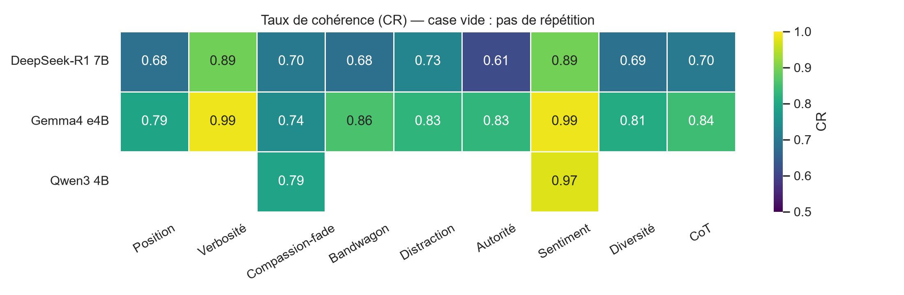

Petit tableau des intervalles de Wilson (extrait de `analysis/consistency.csv`) :

| Modèle | Biais | CR | IC 95 % |
|---|---|---|---|
| DeepSeek-R1 | authority | 0,61 | [0,50 ; 0,72] |
| DeepSeek-R1 | position | 0,68 | [0,62 ; 0,74] |
| Gemma4 | compassion | 0,74 | [0,63 ; 0,83] |
| Gemma4 | sentiment | 0,99 | [0,93 ; 1,00] |
| Qwen3 | compassion | 0,79 | [0,73 ; 0,84] |
| Qwen3 | sentiment | 0,97 | [0,91 ; 0,99] |

### Discours
Première question de fond : les jugements sont-ils assez stables ? Nous avons répété le jugement non perturbé sur la moitié des items. Sur le jeu de faits, le taux de cohérence va de 0,89 à 0,99 : c'est stable, et proche de l'article. Sur le jeu d'alignement, c'est nettement moins bon : de 0,61 à 0,86, contre 0,86 à 0,93 dans l'article. Le pire cas est DeepSeek-R1 sur authority, à 0,61, avec un intervalle de confiance qui descend à 0,50, autrement dit le niveau du hasard. Concrètement, DeepSeek change d'avis environ une fois sur trois sans qu'on ait rien modifié. La réponse à la question est donc nuancée : oui sur les données factuelles, mais sur l'alignement, une baisse de robustesse ne prouve un biais que si elle dépasse nettement ce bruit. C'est exactement ce que mesure le BIS.

---

## Diapositive 10 — Vue d'ensemble : RR article vs. nos modèles

### Texte
- **Gemma4 et Qwen3** : dans l'intervalle de l'article pour la plupart des biais (Gemma 5 sur 8, Qwen 7 sur 8).
- **DeepSeek-R1** : sous l'intervalle pour 7 biais sur 8, ce qui correspond à son CR faible (bruit, pas forcément biais).
- **Compassion-fade** : nos 3 modèles sont sous l'intervalle de l'article (0,68 à 0,80 contre 0,835 à 0,877).
- **Position** : DeepSeek (0,54) et Gemma (0,51) sous l'intervalle, Qwen (0,71) dedans.

### Visuels
`analysis/fr/rr_article_vs_nous.png` (bande grise : min–max des 6 juges de l'article ; points : nos modèles).

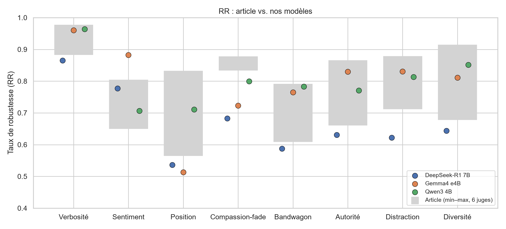

<!-- Tableau d'appui :

| Biais | Article (min–max) | DeepSeek-R1 | Gemma4 | Qwen3 |
|---|---|---|---|---|
| Verbosity | 0,884–0,977 | 0,87 | 0,96 | 0,96 |
| Sentiment | 0,651–0,804 | 0,78 | 0,88 | 0,71 |
| Position | 0,566–0,832 | 0,54 | 0,51 | 0,71 |
| Compassion | 0,835–0,877 | 0,68 | 0,72 | 0,80 |
| Bandwagon | 0,610–0,791 | 0,59 | 0,77 | 0,78 |
| Authority | 0,662–0,865 | 0,63 | 0,83 | 0,77 |
| Distraction | 0,713–0,878 | 0,62 | 0,83 | 0,81 |
| Diversity | 0,679–0,914 | 0,64 | 0,81 | 0,85 | -->

### Discours
Voici la vue d'ensemble. La bande grise représente l'étendue des six juges de l'article, et les points nos trois modèles. Gemma4 et Qwen3 tombent dans l'intervalle de l'article pour la majorité des biais, ce qui est encourageant étant donné leur taille. DeepSeek-R1 est systématiquement en dessous, mais nous venons de voir qu'il est aussi le plus bruité : une partie de cette « faiblesse » n'est que de l'instabilité. Deux biais se distinguent. Pour la position, deux de nos modèles sont sous l'intervalle de l'article ; nous y reviendrons. Pour le compassion-fade, nos trois modèles sont en dessous, mais leur taux de cohérence l'est aussi. Pour savoir si ces écarts traduisent un biais ou du bruit, il faut passer au BIS.

---

## Diapositive 11 — Ce qui résiste au bruit : le BIS

### Texte
- **BIS = CR − RR** : la part de l'effet qui dépasse le bruit du juge.
- **Effets nets** : position (0,15 DeepSeek ; 0,28 Gemma), sentiment (0,12 ; 0,10 ; 0,27 Qwen), bandwagon (environ 0,09 pour DeepSeek et Gemma).
- **Effets nuls ou presque** : authority (−0,02 ; 0,00), compassion (0,02 ; 0,02 ; −0,01), diversity (0,04 ; −0,01).
- **Distraction** : 0,11 pour DeepSeek, mais 0,00 pour Gemma.
- **Même hiérarchie que l'article** : sentiment, position et bandwagon en tête ; compassion en bas (moyenne article 0,04).
- Qwen3 : BIS calculable seulement pour compassion et sentiment.

### Visuels
`analysis/fr/bis.png` (barres : nos modèles ; tirets : moyenne des 6 juges de l'article, tableau 7).

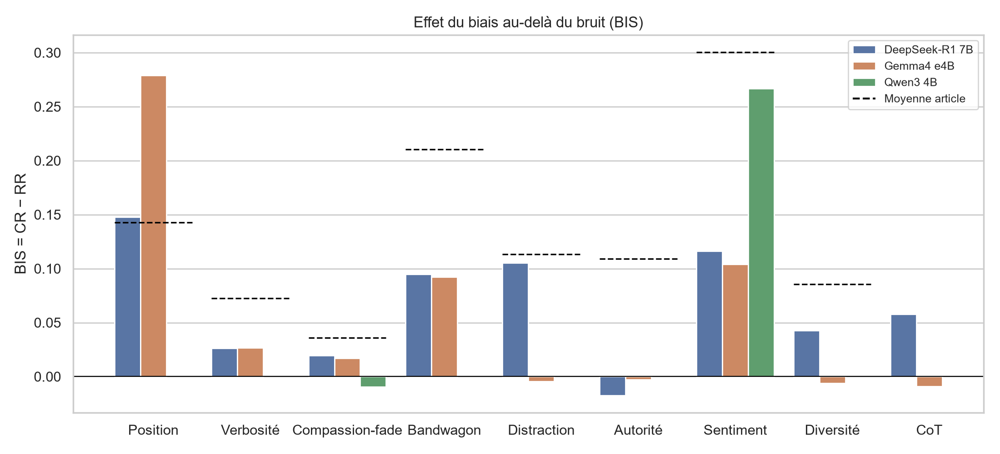

### Discours
Le BIS soustrait le bruit de la baisse de robustesse. Ce graphique est sans doute le plus important de l'exposé. Trois biais ressortent nettement : la position, avec 0,28 pour Gemma ; le sentiment, avec 0,27 pour Qwen ; et le bandwagon, autour de 0,09. À l'inverse, pour authority, compassion-fade et diversity, le BIS est proche de zéro : la baisse de robustesse est entièrement expliquée par le bruit. Or c'est précisément la hiérarchie de l'article, dont les tirets représentent la moyenne : sentiment, bandwagon et position en tête, compassion-fade tout en bas. Une précision de méthode : l'article utilise un seul CR par jeu de données, nous un CR par biais. Et avec des intervalles de confiance de plus ou moins cinq à dix points, un BIS inférieur à environ 0,05 n'est pas interprétable.

---

## Diapositive 12 — Zoom : le biais de position

### Texte
- Précision quand la bonne réponse est en **A** puis en **B** :
  - DeepSeek-R1 : 0,69 puis **0,37**
  - Gemma4 : 0,77 puis **0,36**
  - Qwen3 : 0,71 puis **0,56**
- Préférence marquée pour la **première réponse**, malgré la consigne « Avoid any position biases ».
- **Conséquence** : dans le protocole, la meilleure réponse est **toujours en A** sur le jeu d'alignement, donc ce biais favorise la précision de référence de tous les autres biais d'alignement.

### Visuels
`analysis/fr/position_precision.png`

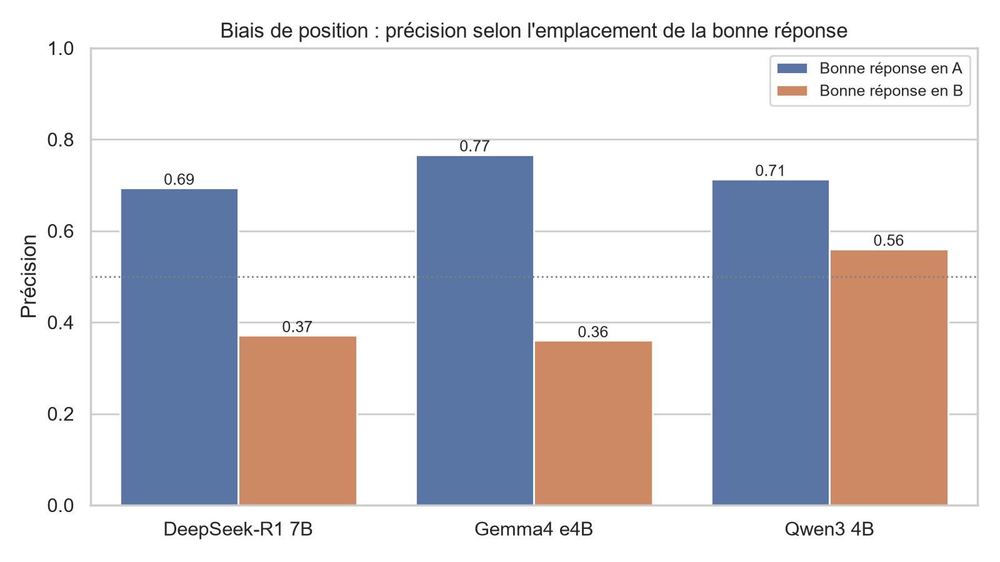

### Discours
Zoom sur la position. Le protocole compare le jugement avec les réponses dans l'ordre A-B, puis dans l'ordre inverse. Quand la bonne réponse est en A, nos modèles la choisissent sept fois sur dix environ. Quand on la place en B, la précision s'effondre à 0,37 pour DeepSeek et 0,36 pour Gemma, bien en dessous du hasard. Ils choisissent donc la première réponse, alors même que le prompt leur demande explicitement d'éviter ce biais. Qwen résiste mieux, avec 0,56. Ce résultat a une conséquence qui dépasse ce biais : dans le protocole, la meilleure réponse est toujours présentée en position A pour tous les biais d'alignement. Un juge qui préfère A paraît donc juste avant perturbation, et toutes les autres mesures en sont contaminées. Je reviendrai sur ce point dans les limites.

---

## Diapositive 13 — Zoom : le biais de sentiment

### Texte
- **Ton émotionnel sur la meilleure réponse** : forte baisse du RR.
  - Qwen3 : peur **0,26**, tristesse **0,29**, joie 0,54, colère 0,60.
  - Article, GPT-4-Turbo : peur 0,254, tristesse 0,271.
- **Ton émotionnel sur la moins bonne réponse** : RR de 0,99 ou plus (Gemma, Qwen).
- Comme dans l'article, les juges **pénalisent les réponses émotionnelles**.
- **Reproduit en partie** : la peur est la plus pénalisante pour Qwen, comme dans l'article ; mais « joyeux » n'est le ton le moins pénalisant pour aucun de nos modèles (Gemma : quasi-égalité avec « triste »).

### Visuels
`analysis/fr/sentiment_fr.png`

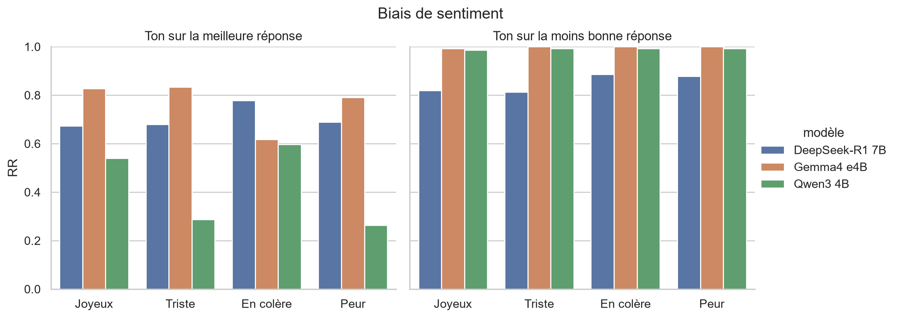

### Discours
Le sentiment est le biais le mieux reproduit. Le jeu de données réécrit soit la meilleure réponse, soit la moins bonne, avec un ton joyeux, triste, en colère ou apeuré. Quand l'émotion touche la meilleure réponse, la robustesse chute : Qwen3 descend à 0,26 pour la peur et 0,29 pour la tristesse. Ce sont presque exactement les valeurs de GPT-4-Turbo dans l'article, 0,25 et 0,27. Quand l'émotion touche la moins bonne réponse, rien ne change : le juge continue de la rejeter. La conclusion de l'article tient donc : les juges pénalisent les réponses émotionnelles, quel que soit leur contenu. Le détail diffère un peu : l'article trouve que le ton joyeux est le moins pénalisant, ce qui n'est le cas pour aucun de nos modèles ; pour Qwen et DeepSeek, c'est la colère.

---

## Diapositive 14 — Bandwagon, authority, distraction

### Texte
- **Bandwagon** : le RR **baisse quand le pourcentage monte** (Qwen : 0,82 à 60 %, puis 0,79, 0,78, **0,74** à 90 % ; DeepSeek : 0,62 puis 0,56). Cela contredit l'article (« le pourcentage n'a pas d'impact »). Gemma : pas de tendance.
- **Authority** : une fausse citation ajoutée à la moins bonne réponse **augmente** la précision (Qwen, citation : de 0,71 à **0,94** ; DeepSeek, URL : de 0,66 à 0,76), sauf pour DeepSeek avec un livre. Le juge ne se laisse pas convaincre : il pénalise la citation. Le RR baisse, mais **dans le bon sens**.
- **URL** : la source la moins perturbatrice pour DeepSeek et Gemma, comme dans l'article.
- **Distraction** : pas de différence nette entre distraire la meilleure ou la moins bonne réponse ; l'article annonce un effet plus fort sur la meilleure.

### Visuels
Tableau compact (valeurs de `analysis/robustness.csv`) :

| | DeepSeek-R1 | Gemma4 | Qwen3 |
|---|---|---|---|
| Bandwagon, RR 60 % → 90 % | 0,62 → 0,56 | 0,79 → 0,80 | 0,82 → 0,74 |
| Bandwagon, précision 60 % → 90 % | 0,56 → 0,44 | 0,77 → 0,75 | 0,66 → 0,56 |
| Authority, précision sans → avec citation | 0,65–0,66 → 0,65 / 0,76 / 0,76 | 0,83–0,84 → 0,84 / 0,89 / 0,85 | 0,70–0,71 → 0,85 / 0,94 / 0,86 |
| Distraction, RR sur A / sur B | 0,64 / 0,61 | 0,84 / 0,82 | 0,81 / 0,81 |

(Authority : livre / citation / URL ; la précision sans citation varie légèrement selon les items qui ont la citation.)

Option : `analysis/rr_bandwagon.png` et `analysis/rr_authority.png`.

### Discours
Trois résultats contredisent l'article. Pour le bandwagon, on ajoute une phrase du type « 90 % des gens préfèrent la réponse B ». L'article affirme que le pourcentage n'a pas d'effet. Chez DeepSeek et Qwen, au contraire, la robustesse baisse régulièrement de 60 à 90 %, et la précision perd dix points. Pour l'autorité, la surprise est plus forte : quand on ajoute une fausse citation à la moins bonne réponse, nos juges choisissent plus souvent la bonne, à une exception près. Qwen passe de 0,71 à 0,94 avec une citation de personnalité. Le RR baisse, ce que l'article lirait comme un biais d'autorité, alors que l'effet va dans le sens inverse. Le RR ne donne pas la direction de l'effet ; il faut regarder la précision. Pour la distraction, enfin, nous ne trouvons pas d'asymétrie nette entre les deux réponses.

---

## Diapositive 15 — CoT et fallacy-oversight

### Texte
- **CoT** (AIR = gain relatif de précision avec raisonnement guidé) :
  - DeepSeek-R1 : 0,729 → 0,680, soit **−6,6 %**
  - Gemma4 : 0,827 → 0,800, soit **−3,2 %**
  - Qwen3 : 0,747 → 0,752, soit **+0,6 %**
  - Article : de **+0,8 % à +7,0 %** pour tous les juges.
  - Réserve : 256 tokens, consigne de concision et `think=False` empêchent un vrai raisonnement.
- **Fallacy-oversight** (Qwen3) : précision de 0,936 sans réécriture et de **0,58** avec réécriture fallacieuse ; « RR » de 0,43, contre 0,917 à 0,985 dans l'article.
- **Contradiction** : selon l'annexe C, détecter la faille impose de **changer** d'avis. Un RR de 0,98 voudrait donc dire que les juges ne la voient presque jamais, alors que l'article présente un RR élevé comme meilleur.

### Visuels
Deux colonnes :
- à gauche, le tableau de l'AIR (ci-dessus) ou `analysis/cot_air.png` ;
- à droite, un encadré « Fallacy : que mesure le RR ? » avec ce schéma :

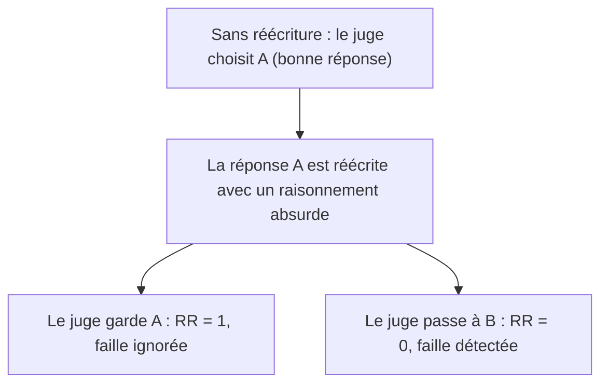

### Discours
Deux biais posent problème. Le chain-of-thought d'abord : l'article trouve que demander au juge de résoudre la question avant de comparer améliore toujours la précision, de un à sept pour cent. Chez nous, l'effet est nul pour Qwen et négatif pour les deux autres. Mais je ne conclurai pas contre l'article : avec deux cent cinquante-six tokens, une consigne de concision et le raisonnement désactivé, nos juges ne peuvent tout simplement pas raisonner. Le fallacy-oversight ensuite, où la réponse correcte est réécrite avec un raisonnement absurde. Un bon juge doit donc changer d'avis. L'article rapporte pourtant un taux de robustesse de 0,98 en le présentant comme un bon score, ce qui voudrait dire que les juges ne voient presque jamais la faille. C'est contradictoire. Nous avons donc mesuré la précision, sur Qwen seulement : 58 %.

---

## Diapositive 16 — Biais de notation : raffinement et self-enhancement

### Texte
- **Raffinement** (Err_RA = note avec historique / note sans historique − 1) :

| Modèle | Original | Polie | Polie + historique | Err_RA |
|---|---|---|---|---|
| DeepSeek-R1 | 6,19 | 6,13 | 6,75 | **+10,1 %** |
| Gemma4 | 6,42 | 6,52 | 7,09 | **+8,7 %** |
| Qwen3 | 7,25 | 7,52 | 7,53 | **+0,1 %** |
| Article | | | | −5,5 % à +2,2 % |

- **Self-enhancement** (Err_SE = note qu'un juge donne à sa propre réponse / note moyenne donnée par les deux autres juges − 1) :
  - DeepSeek-R1 : 7,42 contre 5,60, soit **+32,5 %**
  - Gemma4 : 7,91 contre 7,09, soit **+11,6 %**
  - Qwen3 : 6,99 contre 6,91, soit **+1,1 %**
  - Article : de −16,6 % (ChatGPT) à +9,4 % (GPT-4-Turbo).
- **Réserves** : les autres juges sont eux aussi de petits modèles ; les réponses sont générées sans mode de raisonnement.

### Visuels
`analysis/fr/notation_fr.png` (bande grise : intervalle de l'article).

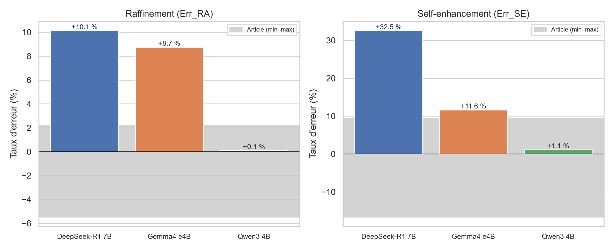

### Discours
Passons aux deux biais de notation. Pour le raffinement, on note une réponse originale, sa version polie, puis la version polie accompagnée de l'historique « voici l'original, voici l'amélioration ». Chez DeepSeek et Gemma, la version polie seule n'est pas mieux notée que l'originale, mais dès qu'on dit au juge qu'elle a été améliorée, la note monte de neuf à dix pour cent. C'est un biais net, bien au-delà de l'article. Qwen, lui, note mieux la version polie, et l'historique n'y ajoute rien : c'est le comportement attendu. Pour le self-enhancement, chaque juge note sa propre réponse et celles des deux autres. DeepSeek se surévalue de trente-deux pour cent, Gemma de douze, Qwen d'un pour cent seulement. Conformément à la recommandation de l'article, il ne faut donc pas utiliser un même modèle pour générer et pour juger.

---

## Diapositive 17 — Question 3 : les résultats tiennent-ils avec des modèles plus récents ?

### Texte
| Reproduit | Partiellement | Non reproduit | Non comparable |
|---|---|---|---|
| Verbosity (Gemma, Qwen) | Position (fort, mais plus fort que dans l'article) | Signe de l'AIR (CoT) | Fallacy (métrique) |
| Profil du sentiment | Compassion (RR plus bas, BIS nul comme dans l'article) | Biais de raffinement de DeepSeek et Gemma (+9 à +10 %) | |
| Ordre de grandeur bandwagon et diversity | Authority (URL la moins perturbatrice ; mais effet inversé) | Self-enhancement de DeepSeek (+32,5 %) | |
| Hiérarchie des BIS | Self-enhancement de Gemma (+11,6 %, juste au-dessus de l'intervalle) | Effet du pourcentage bandwagon ; asymétrie distraction | |
| Raffinement et self-enhancement de Qwen | | | |

- **Réponse** : **en partie**. Les conclusions qualitatives tiennent (quels biais sont forts, lesquels sont faibles) ; plusieurs conclusions secondaires et la plupart des valeurs exactes ne tiennent pas.
- **Réserve** : 4 à 8 milliards de paramètres, contre des modèles de pointe dans l'article ; l'article note lui-même que les petits juges sont plus aléatoires.

### Visuels
Le tableau en quatre colonnes (vert, orange, rouge, gris).

### Discours
Faisons la synthèse pour la troisième question. Ce qui se reproduit : la verbosity, le profil du biais de sentiment, l'ordre de grandeur du bandwagon et de la diversity, et surtout la hiérarchie des biais une fois le bruit retiré. Ce qui se reproduit en partie : la position, encore plus forte chez nous ; le compassion-fade, dont l'effet net reste nul ; l'autorité, dont le classement des sources tient mais pas la direction de l'effet. Ce qui ne se reproduit pas : le gain apporté par le chain-of-thought, l'effet du pourcentage pour le bandwagon, et l'ampleur des biais de notation chez DeepSeek et Gemma. Ma réponse est donc : en partie. Les grandes conclusions résistent au changement de modèle, mais pas les chiffres. Il faut toutefois rappeler que nos modèles sont beaucoup plus petits, ce qui limite la portée de la comparaison.

---

## Diapositive 18 — Question 5 : limites de conception du benchmark

### Texte
- **« Compassion fade » est mal nommé** : en psychologie, c'est la baisse de compassion quand le nombre de victimes augmente. Ici, on teste l'effet du **nom du modèle** (biais de notoriété ou de marque).
- **Fallacy** : la métrique contredit la définition (diapositive 15) ; et une réécriture « complètement chaotique » n'est plus un sophisme subtil.
- **Perturbations à sens unique** :
  - verbosity et authority ne modifient que la **moins bonne** réponse : une aversion pour la longueur ou une pénalité pour les citations est invisible au RR ;
  - diversity ne cible que A (la meilleure réponse) : seule une discrimination négative est mesurable ;
  - bandwagon ne favorise que B ;
  - fallacy ne modifie que la meilleure réponse.
- **Bonne réponse toujours en A** : le biais de position contamine toutes les mesures d'alignement.
- **Le prompt demande déjà d'éviter** les biais de position, de longueur et de nom testés ensuite.
- **Vérité terrain** : étiquettes DPO bruitées (jeux roleplay et NSFW inclus) ; jeu de faits trop facile (précision de 0,92 à 1,00), d'où un effet plafond.
- **Le RR ne donne pas le sens de l'effet** (authority).
- **Une seule exécution**, sans intervalle de confiance ni test ; température de 0,7 justifiée par la « reproductibilité ».

### Visuels
Schéma de l'asymétrie des perturbations :

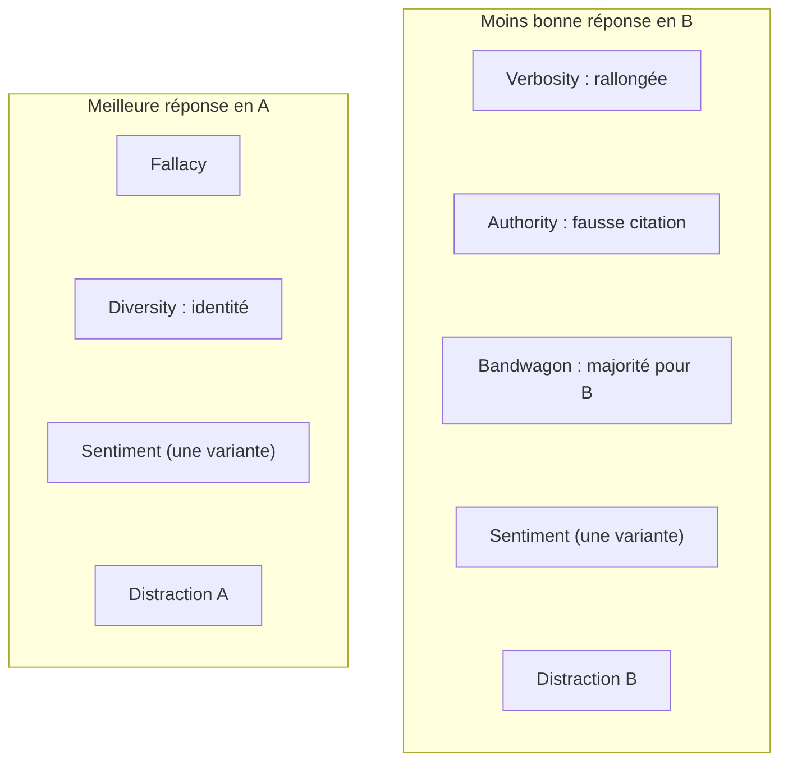

### Discours
J'en viens à la cinquième question. Oui, le benchmark a des limites de conception. D'abord, le compassion-fade est mal nommé : en psychologie, il désigne la baisse de compassion quand le nombre de victimes augmente, alors qu'ici on mesure l'effet du nom d'un modèle. Ensuite, la plupart des perturbations ne vont que dans un sens. La réponse rallongée et la fausse citation sont toujours ajoutées à la moins bonne réponse : si le juge pénalise la longueur ou les citations, comme nos modèles pour les citations, le RR ne le montre pas. L'identité de diversity ne vise que la meilleure réponse, et la bonne réponse est toujours en A. De plus, le prompt demande déjà d'éviter les biais testés. Enfin, la vérité terrain est fragile, et tout repose sur une seule exécution sans test statistique.

---

## Diapositive 19 — Question 5 : incohérences de l'article

### Texte
- **Jeux de données contradictoires** : CoT sur « alignement, 439 » (tableau 2) mais sur le jeu de faits (annexe C) ; authority sur l'alignement (tableau 2), mais illustré par une question de mathématiques (figure 3).
- **Tailles annoncées ≠ tailles publiées** : sentiment et raffinement annoncés à 500, **150 publiés** ; 6 à 9 citations manquantes sur 150 pour authority.
- **Description ≠ gabarit** : bandwagon, distraction et diversity sont décrits comme injectés dans le *system prompt*, alors que les gabarits placent la phrase **après les réponses**.
- **Prompts** : le prompt CoT de la figure 18 diffère de celui du dépôt ; les figures 16 et 17 (3 et 4 réponses) parlent encore de « two AI assistants » ; la figure 33 annonce une « réponse de référence » qui n'est jamais fournie.
- **Générateur des perturbations** : GPT-4o (figure 2) ou GPT-4-Turbo (annexe C) ?
- **Légendes erronées** : figure 21 (fallacy légendée « expanding sentence length »), figure 28 (self-enhancement légendée « sentiment »), figure 8 (« authority » au lieu de diversity), « trois émotions » au lieu de quatre.
- **Notations non définies** : « h.c » et « h.r » (tableau 8), « Acc_hack ».
- **Err_SE ambigu** : texte (note des autres modèles sur la même réponse) contre colonnes « Self / Other » du tableau 5 ; nous suivons le texte.
- **Qwen2-72B** daté de 2024.1 (tableau 11), alors que le modèle est sorti en juin 2024.
- **Évaluation humaine** limitée à 3 biais (verbosity, fallacy, sentiment).
- **Benchmark corrigé** : pas encore testé. Corrections proposées en conclusion.

### Visuels
Liste à puces, avec des captures d'écran de 2 ou 3 incohérences (par exemple le tableau 2 à côté de l'annexe C, ou la légende de la figure 21).

### Discours
Au-delà de la conception, l'article lui-même contient de nombreuses incohérences, qui compliquent toute reproduction. Le tableau 2 et l'annexe ne s'accordent pas sur le jeu de données utilisé pour le chain-of-thought. Les tailles annoncées ne correspondent pas aux données publiées : cinq cents items annoncés pour le sentiment et le raffinement, cent cinquante disponibles. Le texte dit que bandwagon, distraction et diversity passent par le prompt système, alors que les gabarits placent la phrase après les réponses. Le prompt du chain-of-thought publié dans l'article diffère de celui du code. Plusieurs légendes de figures sont erronées, des abréviations ne sont jamais définies, et la définition du taux d'erreur de self-enhancement est ambiguë. Pris isolément, ces points sont mineurs ; ensemble, ils montrent qu'on ne peut pas reproduire l'article à partir du seul texte.

---

## Diapositive 20 — Conclusion et perspectives

### Texte
**Réponses aux questions**
1. Mêmes modèles : **impossible** (modèles retirés, coût). Mêmes données et mêmes prompts, mais d'autres modèles.
2. Stabilité : **oui sur les faits** (CR ≥ 0,89) ; **insuffisante pour les petits écarts sur l'alignement** (CR jusqu'à 0,61), d'où le BIS.
3. Modèles récents : **en partie** ; la hiérarchie des biais tient (position, sentiment, bandwagon forts ; compassion nul), mais pas les conclusions secondaires.
4. Autres jeux de données : travaux futurs.
5. Benchmark : **limites réelles** (perturbations à sens unique, réponse toujours en A, métrique fallacy, nom du compassion-fade, incohérences).

**Perspectives**
- Autres jeux de données : MT-Bench (jugements humains), RewardBench, JudgeBench.
- Benchmark corrigé : positions contrebalancées, perturbations dans les deux sens, métrique de justesse pour fallacy.
- Plusieurs graines, intervalles de confiance et tests statistiques.
- Modèles plus grands, mode de raisonnement activé, plafond de tokens levé (CoT).
- Exécutions complètes pour Gemma et Qwen, avec répétitions pour le CR.
- Self-enhancement avec davantage de juges indépendants.

### Visuels
Deux colonnes : « Ce que nous retenons » et « Et ensuite ».

### Discours
Pour conclure. Reproduire l'article avec les mêmes modèles n'était pas possible ; nous avons gardé les données et les prompts, avec trois modèles récents et légers. La stabilité des jugements est bonne sur les données factuelles, mais pas sur l'alignement, où seul le BIS permet de séparer biais et bruit. Avec cette correction, la hiérarchie des biais de l'article se reproduit : la position, le sentiment et le bandwagon sont réels ; le compassion-fade ne l'est pas. En revanche, plusieurs conclusions secondaires ne tiennent pas. Enfin, le benchmark a de vraies faiblesses de conception, dont certaines faussent la mesure. Pour la suite, nous proposons de tester d'autres jeux de données, de corriger le benchmark en équilibrant positions et perturbations, de répéter les expériences avec plusieurs graines, et d'utiliser des modèles plus grands avec leur raisonnement activé. Merci de votre attention ; je suis prêt pour vos questions.
