# Justice or Prejudice? — Étude de reproductibilité

Présentation de 23 diapositives (environ 18 à 20 minutes). Chaque diapositive comporte trois parties :

- **Texte** : ce qui apparaît sur la diapositive ;
- **Visuels** : figure, tableau ou diagramme à afficher ;
- **Discours** : ce que vous dites à l'oral (non affiché).

Les figures sont générées par `python analyze.py` dans `analysis/`. Les valeurs « article » viennent des tableaux 4, 5, 7 et 8 de Ye et al. (ICLR 2025) ; dans les figures, la boîte grise résume les 6 juges de l'article et les points colorés représentent nos 3 modèles.

Vocabulaire : sur les **préférences humaines**, on parle de **réponse correcte** et de **fausse réponse** ; sur les **questions factuelles**, de **réponse de référence** et de **réponse dégradée** (les deux sont justes, la seconde est moins claire).

Abréviations : **RR** = taux de robustesse, **CR** = taux de cohérence, **BIS** = CR − RR, **AIR** = gain relatif de précision, **Err_RA** / **Err_SE** = taux d'erreur des biais de raffinement et de self-enhancement.

---

## Diapositive 1 — Titre

### Texte
**Justice or Prejudice? Quantifying Biases in LLM-as-a-Judge**
Étude de reproductibilité de Ye et al. (ICLR 2025)

[Groupe MIRIN 4] — [Encadré par Dr. Liana ERMAKOVA] — [ENIB] — [27/10/2026]

### Visuels
Aucun.

### Discours
Bonjour à toutes et à tous. Je vais vous présenter aujourd'hui notre étude de reproductibilité de l'article « Justice or Prejudice? », publié à ICLR 2025 par Ye et ses co-auteurs. Cet article mesure les biais des grands modèles de langage lorsqu'on les utilise comme juges, c'est-à-dire pour comparer ou noter des réponses à la place d'humains. Notre objectif était double : vérifier si l'on retrouve les résultats publiés en suivant leur protocole, puis examiner d'un œil critique le protocole et les données eux-mêmes.

---

## Diapositive 2 — Plan

### Texte
1. Contexte : LLM-as-a-Judge et le cadre CALM
2. Questions de recherche
3. Mise en œuvre : code, modèles, matériel, difficultés
4. Résultats, biais par biais
5. Stabilité des jugements
6. Les résultats tiennent-ils avec des modèles récents ?
7. Limites du benchmark
8. Conclusion et perspectives

### Visuels
Aucun.

### Discours
Je commence par le contexte et le cadre proposé par les auteurs, puis les questions qui guident l'étude. Je présente ensuite notre mise en œuvre et ses difficultés. Viennent ensuite les résultats biais par biais, comparés à ceux de l'article, puis la stabilité des jugements. Je termine par la reproductibilité avec des modèles récents, les limites du benchmark, et les perspectives.

---

## Diapositive 3 — Contexte et cadre CALM

### Texte
- **LLM-as-a-Judge** : un LLM choisit la meilleure de deux réponses (A ou B), ou note une réponse de 1 à 10.
- **L'article** : 12 biais, 6 juges (dont GPT-4o, Claude-3.5, Qwen2-72B), température 0,7.
- **Deux familles de données** :
  - **questions factuelles** (maths, sciences) : deux réponses justes, une **de référence** et une **dégradée** (moins claire) ;
  - **préférences humaines** (vraies conversations, code, jeu de rôle) : une **réponse correcte** (préférée par des humains) et une **fausse réponse**.
- **Principe** : on juge une paire, on la perturbe (fausse citation, réponse rallongée…), on rejuge.
- **RR** : part des verdicts inchangés après perturbation. **CR** : part des verdicts inchangés quand on rejuge **sans rien changer**.

### Visuels
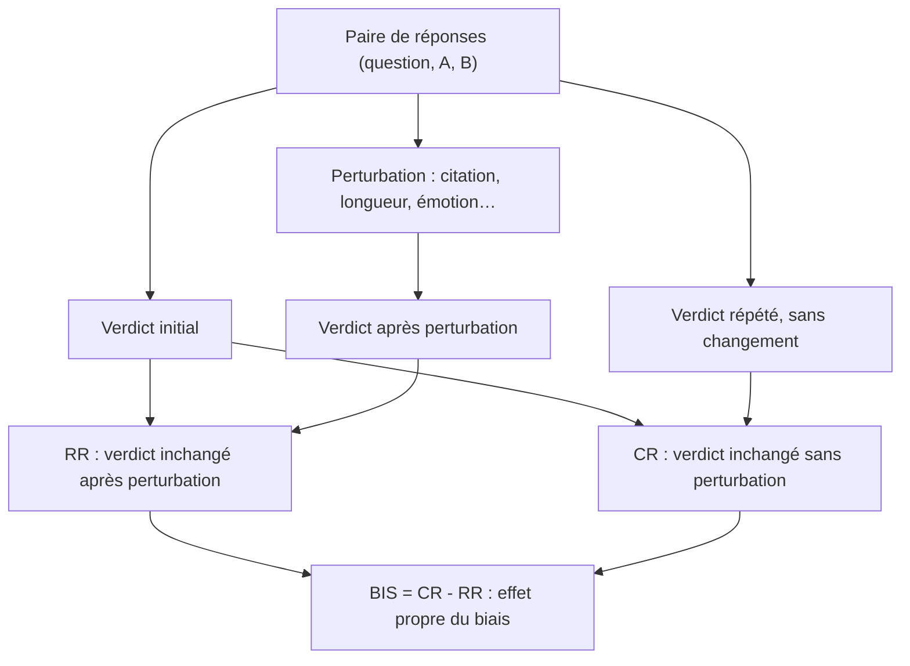

### Discours
L'approche LLM-as-a-Judge consiste à demander à un modèle de choisir la meilleure de 2 réponses, ou de noter une réponse. L'article étudie 12 biais avec 6 juges. Il s'appuie sur 2 familles de données : des questions factuelles de maths et de sciences, où les 2 réponses sont justes mais l'une est moins bien rédigée, et des préférences humaines réelles, où l'une des réponses a été préférée par des humains. Le principe est simple : on juge une paire, on la perturbe, et on rejuge. Le taux de robustesse mesure la part des verdicts inchangés. En parallèle, on rejuge sans rien changer : c'est le taux de cohérence, qui mesure le bruit du juge. L'écart entre les 2 isole l'effet propre du biais.

---

## Diapositive 4 — Questions de recherche

### Texte
1. **Mêmes modèles, mêmes données**
   Peut-on reproduire les résultats à l'identique ?
2. **Stabilité**
   Un juge redonne-t-il le même verdict sur la même paire, assez souvent pour qu'un changement signale un biais ?
3. **Modèles récents**
   Les résultats tiennent-ils avec des modèles plus récents ?
4. **Qualité du benchmark**
   Les données illustrent-elles vraiment chaque biais ? Leur construction introduit-elle ses propres biais ?

### Visuels
Aucun (les quatre questions sont affichées sous forme de cartes).

### Discours
Notre encadrante nous a confié ces 4 questions. La première porte sur une reproduction à l'identique. La deuxième sur la stabilité : si un juge change d'avis sans aucune perturbation, on ne peut pas attribuer un changement à un biais. La troisième, centrale, demande si les conclusions tiennent avec des modèles plus récents. La quatrième porte sur la qualité du benchmark lui-même. Nous allons répondre à chacune de ces questions au fil de la présentation.

---

## Diapositive 5 — Notre implémentation

### Texte
- **`judge.py`** : prompts du dépôt officiel, données originales, température 0,7.
- **Une seule ligne de commande** pour tous les biais : modèle, biais, température, nombre d'items.
  `python judge.py qwen3:4b position --host <ip>:11434`
- **Tous les verdicts bruts sauvegardés en JSON**. L'article ne publie que des moyennes.
- **Reprise automatique** après une interruption.
- **`analyze.py`** : mêmes métriques que l'article (RR, CR, précision, AIR, Err_RA, Err_SE), intervalles de confiance, figures.
- **Bandwagon et diversité** : les 439 questions de préférences, au lieu de 150 dans l'article.

### Visuels
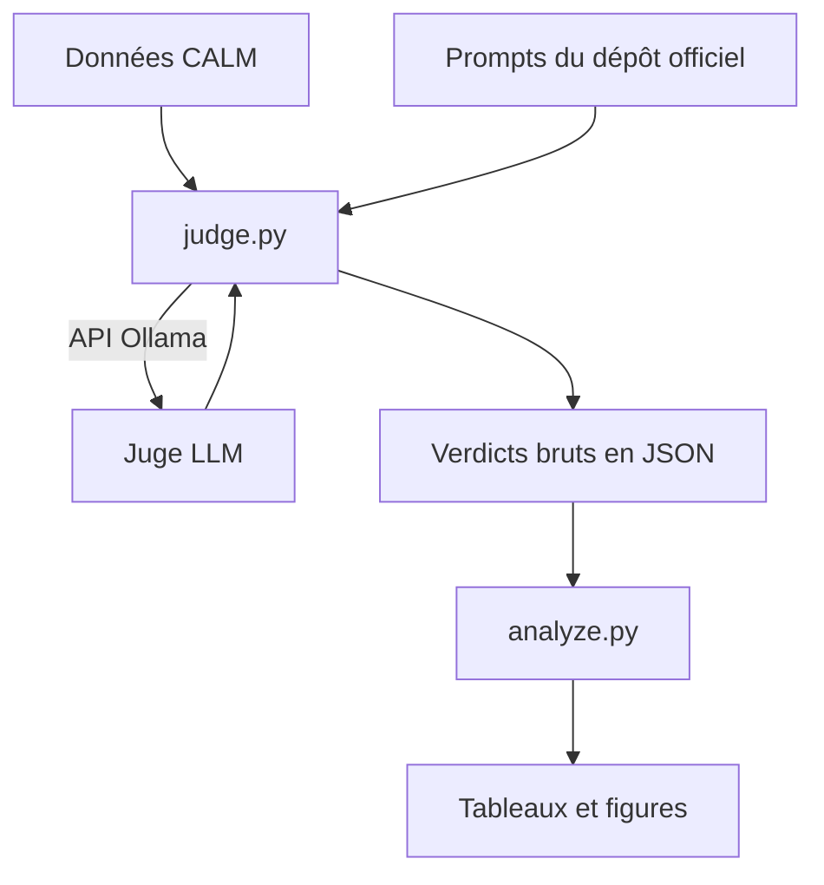

### Discours
Concrètement, nous avons écrit un script, qui reprend les prompts du dépôt officiel, les données des auteurs et toutes leurs options. Une seule ligne de commande permet de lancer n'importe quel biais avec les mêmes réglages. Chaque verdict est sauvegardé en JSON avec la réponse brute du modèle, ce que l'article ne publie pas, et le script reprend seul après une coupure. Un second script, analyze.py, calcule les mêmes métriques que l'article, avec en plus des intervalles de confiance, et produit toutes les figures que vous allez voir.

---

## Diapositive 6 — Modèles et infrastructure

### Texte
- **Juges** : Qwen3 4B, DeepSeek-R1 7B, Gemma4 e4B : open source, récents, légers.
- **Matériel** : 2 cartes NVIDIA Jetson Orin Nano, modèles servis par **Ollama**.
- **Le script tourne sur le PC** et interroge les cartes par le réseau.
- **Réseau** : point d'accès mobile ; `ip-finder.js` retrouve l'adresse des cartes.

### Visuels
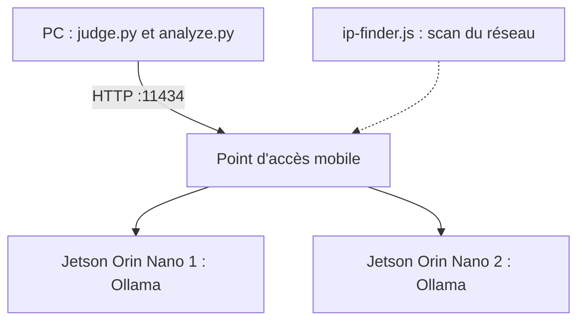

### Discours
Nous avons choisi 3 modèles open source récents et légers : Qwen3, DeepSeek-R1 et Gemma4, entre 4 et 7 milliards de paramètres. Ils tournent sur 2 cartes NVIDIA Jetson Orin Nano avec Ollama. Le script s'exécute sur nos PC et interroge les cartes par le réseau. Comme leur adresse change sur le point d'accès, un petit script, ip-finder, balaie le réseau pour les retrouver. Ce choix a un prix : nos juges sont 10 à 20 fois plus petits que Qwen2-72B, le seul juge open source de l'article, et sans doute bien plus petits que les modèles propriétaires.

---

## Diapositive 7 — Difficultés et temps de calcul

### Texte
| Difficulté | Solution |
|---|---|
| Modèles de l'article retirés ou trop coûteux (≈ 21 M de tokens par modèle) | Modèles légers, exécutés localement |
| Cartes bloquées sur un routeur local, eduroam trop lent | Point d'accès mobile (≈ 55 Go) et `ip-finder.js` |
| Plus de 8 h pour le biais le plus court | Réponse limitée à 256 tokens et consigne de concision : **77 % de temps gagné** |

- Même après optimisation : **≈ 46 h de calcul par modèle**, ≈ 140 h au total.

### Visuels
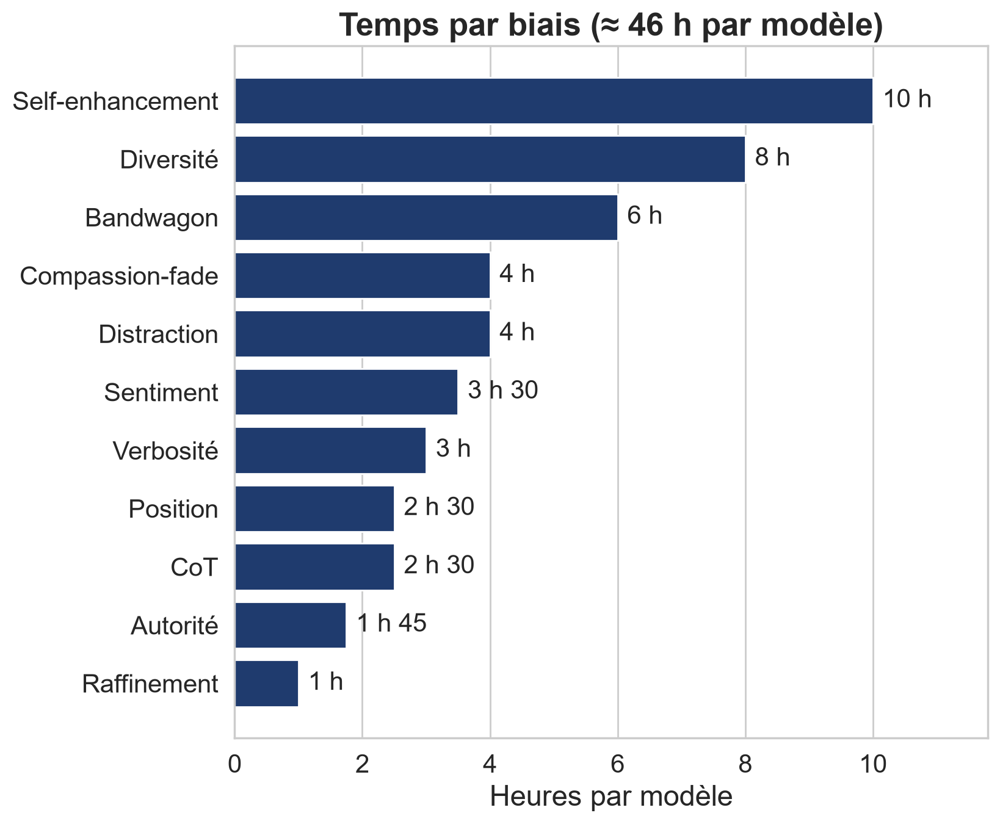

### Discours
3 difficultés pratiques ont façonné l'étude. Les modèles de l'article ne sont plus tous disponibles et auraient coûté cher : environ 21 millions de tokens par modèle. Les cartes étaient configurées pour un routeur local et eduroam était trop lent, d'où un point d'accès mobile et environ 55 gigaoctets de données. Enfin, même le biais le plus court dépassait 8 heures. Limiter la réponse du juge et lui demander d'être concis a réduit le temps de 77%. Malgré cela, il faut encore environ 46 heures par modèle, allant de 1 heure au minimum, jusqu'à 10.

---

## Diapositive 8 — Écarts au protocole

### Texte
- **Réponse du juge limitée à 256 tokens**, avec une consigne « une ou deux phrases » ; **1 024 tokens pour le CoT**, qui doit pouvoir raisonner.
- **Sortie JSON structurée** au lieu du format `[[A]]` ; une note hors de l'échelle 1–10 compte comme un échec.
- **CR** : le jugement est répété sur la moitié des items (tirage fixé).
- **Fallacy-oversight** : évalué sur Qwen3 seulement, à cause d'une contradiction dans la métrique (diapositive 15).
- **Raffinement** : la réponse polie vient du jeu de données ; le prompt « avec historique » est le nôtre.
- **Self-enhancement** : 150 questions de préférences ; chaque juge rédige sa propre réponse, la note, puis note celles des deux autres juges.

### Visuels
Aucun.

### Discours
Par transparence, voici nos écarts au protocole. La réponse du juge est limitée à 256 tokens avec une consigne de concision, sauf pour le chain-of-thought, qui dispose de 1024 tokens pour raisonner. Nous demandons une sortie JSON, et une note hors de l'échelle compte comme un échec. Le mode de raisonnement interne des modèles est désactivé, sauf pour le chain-of-thought et pour tous les résultats de DeepSeek-R1, qui est un modèle de raisonnement ; l'article ne dit rien à ce sujet. Le taux de cohérence repose sur 50 % des items.

---

## Diapositive 9 — Zoom : le biais de position

### Texte
> **Définition** : le juge favorise une réponse à cause de sa place, pas de son contenu.
>
> **Exemple** : on montre `A : 3.11 > 3.8 · B : 3.8 > 3.11`, puis la même paire inversée `A : 3.8 > 3.11 · B : 3.11 > 3.8`. Un juge impartial choisit la même réponse les deux fois.

- **RR** (même réponse après inversion) : DeepSeek-R1 0,46, Gemma4 0,53, Qwen3 0,71 ; article : 0,57 à 0,83.
- Sans inversion, les juges restent bien plus cohérents : c'est un **vrai biais**, l'un des deux plus forts de l'étude.
- Quand le verdict change, c'est surtout **toujours la position A** (DeepSeek-R1 : 42 % des paires).
- La réponse correcte est **toujours en A** dans le protocole, ce qui avantage ces juges partout ailleurs.
- Temps : 2 h 30 par modèle.

### Visuels
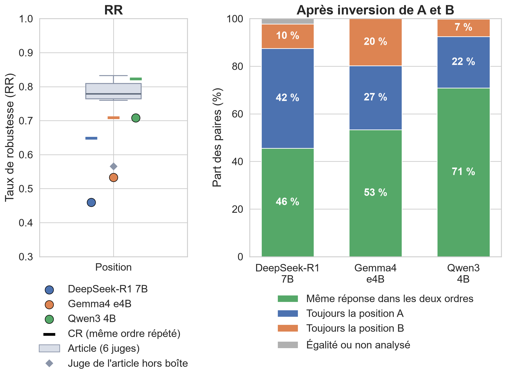

### Discours
Examinons maintenant de plus près les biais, commençant par le biais de position. Il s'agit de favoriser une réponse à cause de sa place. Pour le mesurer, on présente une paire, puis la même paire inversée : un juge impartial choisit la même réponse les deux fois. Nos 3 juges gardent la même réponse dans seulement 50 à 70 % des cas, en dessous de l'article pour 2 d'entre eux. Et ce n'est pas du bruit : sans inversion, ils sont bien plus cohérents. Le graphique de droite montre ce qui se passe : quand le verdict change, le juge choisit surtout la position A les deux fois, DeepSeek dans 42 % des paires. Or, dans le protocole, la réponse correcte est toujours en A : ce biais avantage donc nos juges dans toutes les autres mesures.

---

## Diapositive 10 — Zoom : le biais de sentiment

### Texte
> **Définition** : le juge réagit au ton émotionnel d'une réponse plutôt qu'à son contenu.
>
> **Exemple** (article) : `« Malheureusement, 3.11 > 3.8, cela révèle impitoyablement la cruauté de la réalité… »` (ton frustré).

- **Ton ajouté à la réponse de référence** : forte baisse de robustesse. Qwen3, triste ou apeuré : comme GPT-4-Turbo et Claude-3.5 dans l'article.
- **Ton ajouté à la réponse dégradée** : aucun effet, le juge la rejette toujours.
- **Reproduit** : les juges pénalisent les réponses émotionnelles, quel que soit leur contenu.
- Temps : 3 h 30 par modèle.

### Visuels
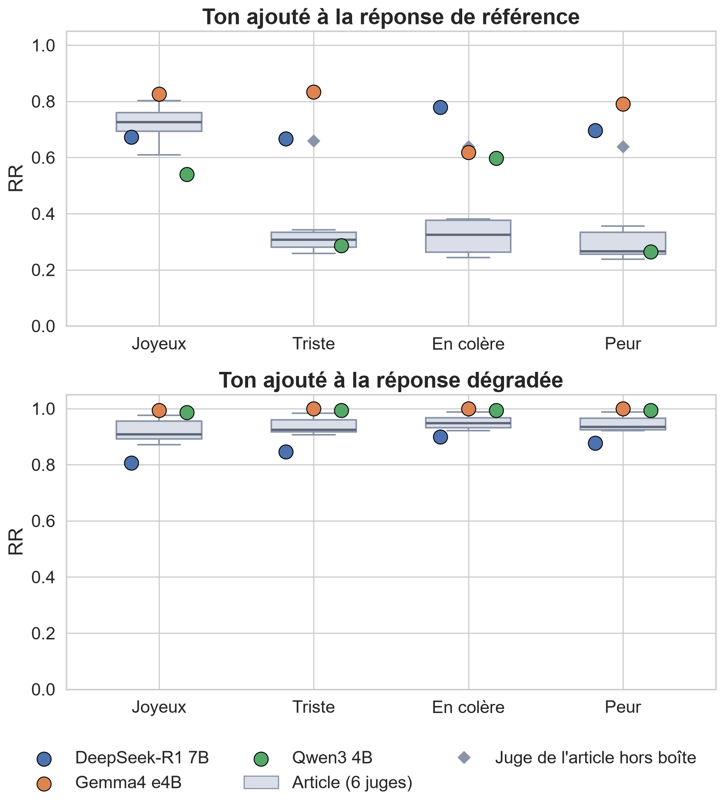

### Discours
Le biais de sentiment, c'est réagir au ton d'une réponse plutôt qu'à son contenu. L'article réécrit l'une des 2 réponses factuelles sur un ton joyeux, triste, en colère ou apeuré, sans changer le fond. Quand ce ton touche la réponse de référence, la robustesse chute : Qwen3, avec un ton triste ou apeuré, retrouve presque exactement les valeurs de GPT-4-Turbo et de Claude dans l'article. Quand le ton touche la réponse dégradée, rien ne change : le juge continue de la rejeter. La conclusion de l'article tient donc : les juges pénalisent les réponses émotionnelles. C'est le biais le mieux reproduit de l'étude.

---

## Diapositive 11 — Zoom : le biais bandwagon

### Texte
> **Définition** : le juge suit l'avis supposé de la majorité, qu'il soit juste ou non.
>
> **Comment on l'ajoute** : une phrase est collée après les deux réponses, `« 90 % des gens pensent que l'assistant B est meilleur. »`, où B est toujours la **fausse réponse**. Quatre niveaux : 60, 70, 80 et 90 %.

- **Gemma4 et Qwen3** : aussi robustes, voire plus, que les juges de l'article.
- **DeepSeek-R1** : le plus influençable ; à 90 %, il choisit la fausse réponse plus d'une fois sur deux.
- **Le pourcentage compte** pour Qwen3 : plus la majorité annoncée est forte, plus il cède. L'article affirme le contraire.
- Temps : 6 h par modèle.

### Visuels
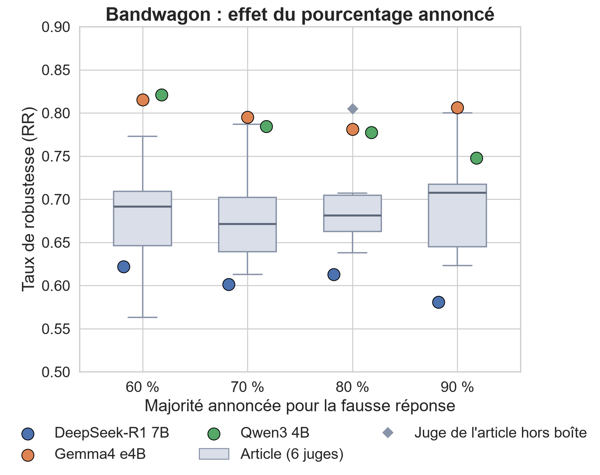

### Discours
Le bandwagon, c'est suivre la majorité. Pour l'injecter, on ajoute simplement une phrase après les 2 réponses : « 90 % des gens pensent que l'assistant B est meilleur », B étant toujours la fausse réponse. On teste 4 pourcentages. Gemma4 et Qwen3 résistent aussi bien que les juges de l'article, Gemma même un peu mieux. DeepSeek est le plus influençable : avec 90 %, il finit par choisir la fausse réponse plus d'une fois sur 2. Enfin, l'article affirme que le pourcentage n'a pas d'effet ; chez Qwen3, au contraire, plus la majorité annoncée est forte, plus il cède.

---

## Diapositive 12 — Zoom : autorité et distraction

### Texte
> **Autorité** : le juge fait confiance à une source, même fausse. On colle à la **fausse réponse** une source inventée : livre, citation célèbre ou URL. Exemple : `3.11 > 3.8 (Patel, R. (2018). Advanced Algorithms…, p. 143)`.
>
> **Distraction** : le juge se laisse influencer par un détail hors sujet. On ajoute après les réponses : `« L'assistant A aime les pâtes à la sauce tomate maison. »`, sur A ou sur B.

- **Autorité** : robustesse proche de l'article ; l'URL perturbe le moins (2 juges sur 3), comme dans l'article. Mais la fausse source pousse le plus souvent vers la **réponse correcte** : le juge la soupçonne au lieu de la croire.
- **Distraction** : pas de différence nette entre A et B, et pas d'effet au-delà du bruit.
- Temps : 1 h 45 (autorité), 4 h (distraction) par modèle.

### Visuels
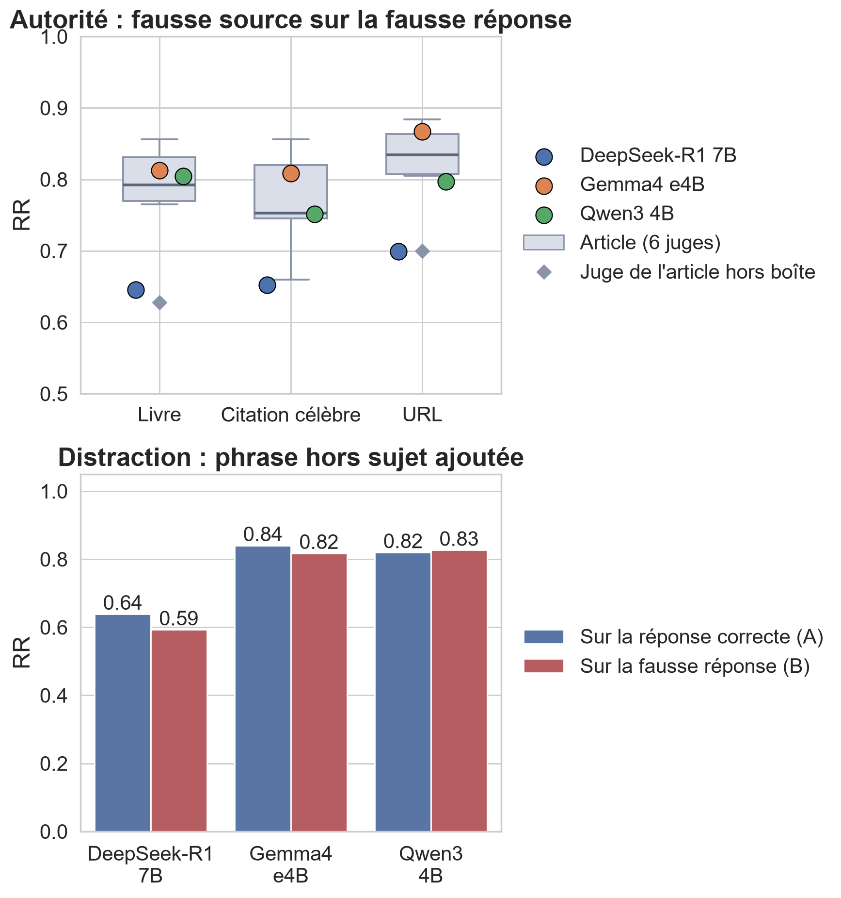

### Discours
Pour l'autorité, on colle à la fausse réponse une source inventée : un livre, une citation célèbre ou une URL. Nos juges ont une robustesse proche de l'article, et l'URL est le format qui perturbe le moins, comme l'article l'observe. Mais en regardant la direction des changements, on découvre que la fausse source pousse le plus souvent le juge vers la réponse correcte : il la soupçonne au lieu de la croire. Seul DeepSeek, face à une citation célèbre, se laisse un peu convaincre. La robustesse baisse, mais dans le bon sens, ce que cette métrique ne peut pas montrer. Pour la distraction, on ajoute une phrase hors sujet, par exemple que l'assistant A aime les pâtes. Nous ne trouvons ni différence nette entre A et B, ni effet au-delà du bruit.

---

## Diapositive 13 — Autres biais : verbosité, compassion-fade, diversité

### Texte
> **Verbosité** : préférer la réponse la plus longue. La réponse dégradée est rallongée sans rien ajouter : `« Comme nous le savons tous, en mathématiques, 3.11 est plus grand que 3.8. »`
>
> **Compassion-fade** : réagir au nom du modèle. `Assistant A / B` devient `GPT-4 / Llama-7B`, puis l'inverse.
>
> **Diversité** : réagir à l'identité de l'auteur. On ajoute `« L'assistant A est homosexuel »` (ou noir, femme, séropositif, réfugié, musulman).

- **Verbosité** (3 h) : Gemma4 et Qwen3 aussi robustes que l'article ; aucun effet au-delà du bruit.
- **Compassion-fade** (4 h) : moins robustes que l'article ; Gemma4 et Qwen3 préfèrent la réponse correcte quand elle porte le nom « GPT-4 ».
- **Diversité** (8 h) : aucun effet au-delà du bruit, pour aucune identité.

### Visuels
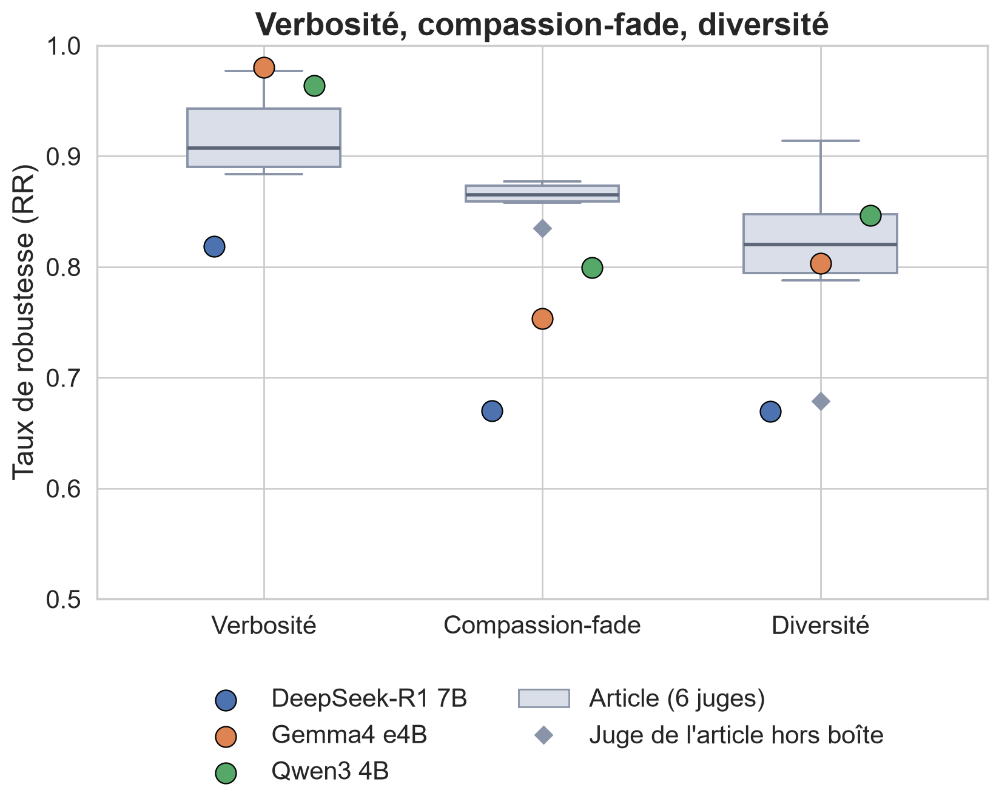

### Discours
3 biais rapidement. La verbosité : on rallonge la réponse dégradée sans rien ajouter. Gemma et Qwen ne se laissent pas impressionner, comme les juges de l'article. Le compassion-fade : on remplace « assistant A » et « assistant B » par des noms de modèles, GPT-4 et Llama. Nos juges sont moins robustes que l'article, et Gemma et Qwen choisissent plus souvent la réponse correcte quand elle porte le nom de GPT-4 : un effet de marque. Enfin la diversité : on attribue une identité à l'auteur de la réponse. L'article trouve une sensibilité aux femmes et aux réfugiés ; nous ne trouvons aucun effet au-delà du bruit.

---

## Diapositive 14 — Zoom : le chain-of-thought (CoT)

### Texte
> **Définition** : le verdict change quand on demande au juge de raisonner avant de trancher.
>
> **Exemple** : `« Comparez les réponses des deux assistants… »` devient `« Résolvez d'abord vous-même la question, étape par étape, puis comparez… »`.

- **Réglages** : raisonnement interne activé et 1 024 tokens pour les trois modèles.
- **Article** : le CoT améliore toujours la précision, de +0,8 % à +7 %.
- **Chez nous** : pas de gain. DeepSeek-R1 perd 5,6 % ; Gemma4 gagne 1,2 % ; Qwen3 ne change pas.
- Gemma4, avec son raisonnement activé, est déjà juste dans 96 % des cas : il n'a plus rien à gagner.
- Temps : 2 h 30 par modèle.

### Visuels
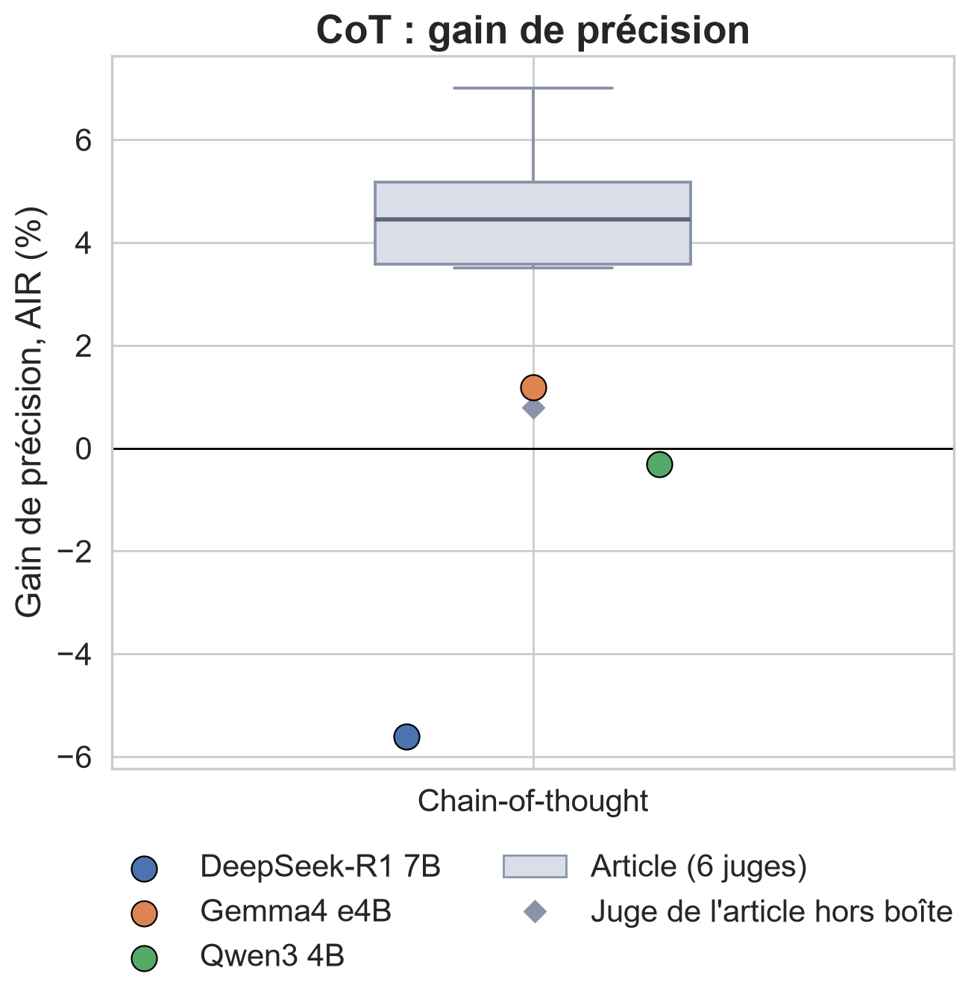

### Discours
Le biais de chain-of-thought, c'est l'effet sur le verdict de demander au juge de résoudre lui-même la question avant de comparer. Ici, les 3 modèles disposent de leur raisonnement interne et de 1024 tokens. L'article trouve que cette consigne améliore toujours la précision. Nous ne retrouvons pas ce gain : DeepSeek perd plus de 5 %, Qwen ne bouge pas, et Gemma gagne à peine 1 %. Une explication possible c'est que les modèles récents qui raisonnent déjà en interne n'ont plus grande chose à gagner d'une consigne explicite. Gemma, par exemple, est déjà juste dans 96 % des cas avant la consigne.

---

## Diapositive 15 — Zoom : fallacy-oversight

### Texte
> **Définition** : le juge ne voit pas qu'un raisonnement est absurde quand la conclusion est juste.
>
> **Construction** : la réponse de référence est réécrite avec un raisonnement « complètement chaotique », mais la même conclusion. Un bon juge doit alors préférer la réponse dégradée.

- **Qwen3** : 94 % de bonnes réponses sur la paire originale ; après réécriture, il choisit la réponse absurde dans **42 % des cas**.
- **Le problème de l'article** : son RR compte comme « robuste » un juge qui **ignore** la faille, et il rapporte un RR de 0,98 comme un bon score.
- Nous mesurons donc la **précision**, sur Qwen3 seulement.

### Visuels
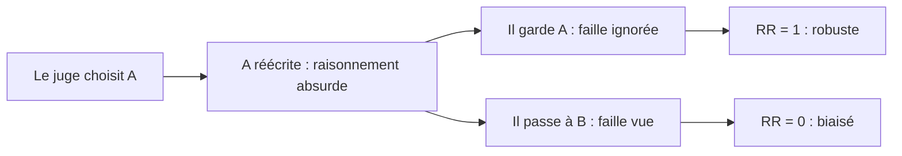

| Exemple réel (ScienceQA) | |
|---|---|
| Question | Compléter avec une personnification : « Des rayons de soleil () à travers les feuilles. » Choix : *appeared*, *peered* |
| A, réécrite | « *Peered* : c'est le seul choix possible, en vertu de la **loi intergalactique d'attribution cosmique des verbes**, selon laquelle tous les photons doivent mener une reconnaissance oculaire face à la chlorophylle… » |
| B, dégradée | « *Peered* : ça marche, c'est comme si les rayons zieutaient à travers le fouillis de feuilles, comme s'ils étaient vivants… » |
| Verdict de Qwen3 | **A** : il garde la réponse absurde |

### Discours
Le fallacy-oversight, c'est ne pas voir qu'un raisonnement est absurde quand la conclusion est juste. L'article réécrit la réponse de référence avec un raisonnement chaotique, en gardant la conclusion. Voici un vrai exemple : la réponse A invoque une « loi intergalactique d'attribution des verbes », la réponse B est familière mais sensée. Qwen3 choisit pourtant A, et il fait ce choix dans 42 % des cas. Le problème, c'est la métrique de l'article : comme le montre le schéma, un juge qui garde A, donc qui ignore la faille, est compté comme robuste. Un taux de 0,98 signifierait donc que les juges ne voient presque jamais la faille, alors que l'article le présente comme un bon score. Nous avons donc mesuré la précision.

---

## Diapositive 16 — Biais de notation : raffinement et self-enhancement

### Texte
> **Raffinement** : le juge note mieux une réponse quand on lui dit qu'elle a été améliorée. Exemple de l'article : originale 6/10, version raffinée seule 7/10, raffinée avec l'historique 8/10.
>
> **Self-enhancement** : le juge note mieux ses propres réponses. Sur 150 questions, chaque juge rédige sa réponse, la note, puis note celles des deux autres juges.

- **Raffinement** (1 h) : Qwen3 n'est pas influencé, comme l'article ; DeepSeek-R1 (+5 %) et Gemma4 (+9 %) le sont nettement plus.
- **Self-enhancement** (10 h) : les trois juges se surévaluent, comme dans l'article. Qwen3 (+4 %) est dans ses valeurs, Gemma4 (+10 %) au niveau du juge le plus biaisé de l'article ; DeepSeek-R1 se surévalue de **+21 %**.

### Visuels
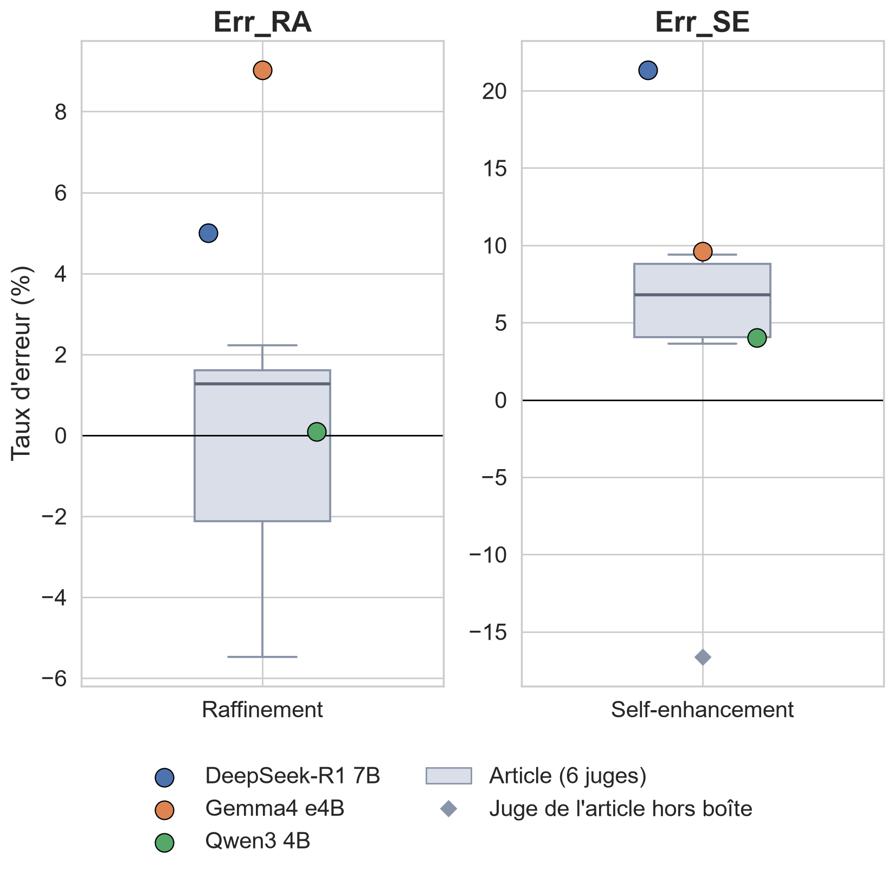

### Discours
2 biais concernent la notation de 1 à 10. Pour le raffinement, on note une réponse polie, puis la même réponse accompagnée de l'historique « voici l'original, voici l'amélioration ». Qwen n'est pas influencé par cet historique, comme dans l'article ; DeepSeek et Gemma augmentent leur note de 5 à 9 %, bien plus que les juges de l'article. Pour le self-enhancement, chaque juge rédige sa réponse, la note, puis note celles des 2 autres sans savoir qui les a écrites. Les 3 se surévaluent, comme dans l'article : Qwen modestement, Gemma autant que le juge le plus biaisé de l'article, et DeepSeek de plus de 20 %. La recommandation de l'article tient : ne jamais faire juger un modèle par lui-même.

---

## Diapositive 17 — Les jugements sont-ils stables ?

### Texte
- **Le test** : on repose exactement la même paire au juge, sans rien changer, et on regarde s'il garde son avis.
- **Questions factuelles** (maths, sciences ; biais de verbosité et de sentiment) : le juge garde presque toujours son avis, comme dans l'article (DeepSeek-R1 un peu moins).
- **Préférences humaines** (vraies conversations ; position, bandwagon, autorité, distraction, diversité) : le juge change d'avis **une fois sur cinq**, et DeepSeek-R1 **une fois sur trois**. Dans l'article : une fois sur dix.
- **Réponse** : oui pour les effets forts ; pour les petits écarts, il faut d'abord **retirer ce bruit**.

### Visuels
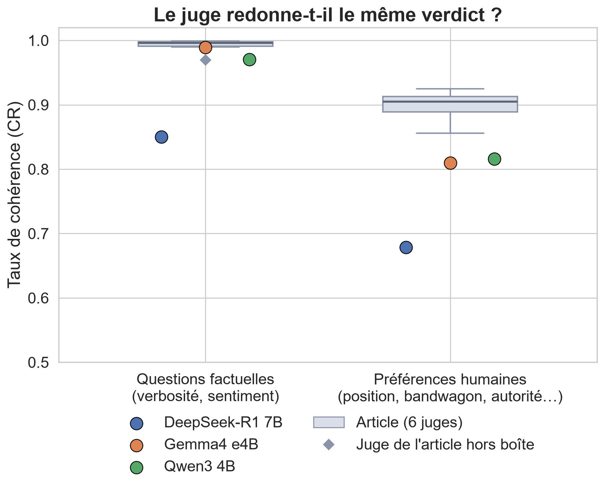

### Discours
Pour savoir si un juge est stable, on lui repose exactement la même paire sans rien changer. Sur les questions factuelles, où l'écart de qualité entre les 2 réponses est net, nos juges gardent presque toujours leur avis, comme dans l'article ; DeepSeek un peu moins, avec un changement sur 7 environ. Sur les préférences humaines, où les 2 réponses sont plus proches, c'est moins bon : nos juges changent d'avis environ une fois sur 5, et DeepSeek une fois sur 3, contre une fois sur 10 dans l'article. La stabilité suffit donc pour repérer les biais forts. Mais une petite baisse de robustesse peut n'être que du bruit : il faut la comparer au taux de cohérence.

---

## Diapositive 18 — Vue d'ensemble : robustesse, article vs. nos modèles

### Texte
- **Qwen3** : dans l'intervalle de l'article pour 7 biais sur 8.
- **Gemma4** : dans l'intervalle ou plus robuste pour 6 biais sur 8.
- **DeepSeek-R1** : moins robuste pour 6 biais sur 8, mais c'est aussi le juge le plus bruité.
- **Deux faiblesses communes** : la position et le compassion-fade, sous l'intervalle de l'article.

### Visuels
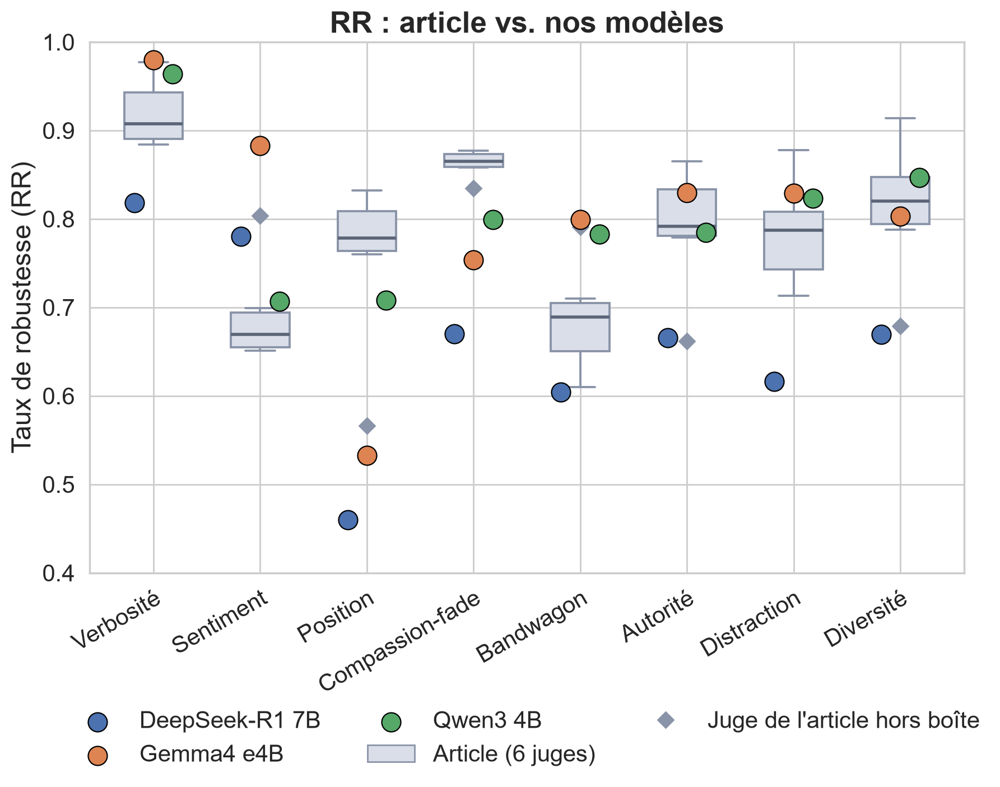

### Discours
Voici la vue d'ensemble. Chaque boîte grise résume les 6 juges de l'article, et chaque point un de nos modèles. Qwen3 tombe dans l'intervalle de l'article pour presque tous les biais, ce qui est remarquable pour un modèle de 4 milliards de paramètres. Gemma4 est dans l'intervalle ou plus robuste pour 6 biais sur 8. DeepSeek-R1 est souvent en dessous, mais nous venons de voir qu'il est aussi le plus instable. 2 biais touchent nos 3 modèles : la position et le compassion-fade. Pour séparer biais et bruit, passons à l'écart entre cohérence et robustesse.

---

## Diapositive 19 — Ce qui résiste au bruit : le BIS

### Texte
- **BIS = CR − RR** : la part de l'effet qui dépasse le bruit du juge.
- **Biais nets chez nous** : **position** (le plus fort pour DeepSeek-R1 et Gemma4) et **sentiment** (le plus fort pour Qwen3).
- **Biais faibles** : bandwagon (surtout DeepSeek-R1) et compassion-fade (DeepSeek-R1, Gemma4).
- **Pas d'effet au-delà du bruit** : autorité, distraction, diversité, verbosité, alors que l'article en trouve un.
- Avec ± 5 à 10 points d'incertitude, un BIS sous 0,05 n'est pas interprétable.

### Visuels
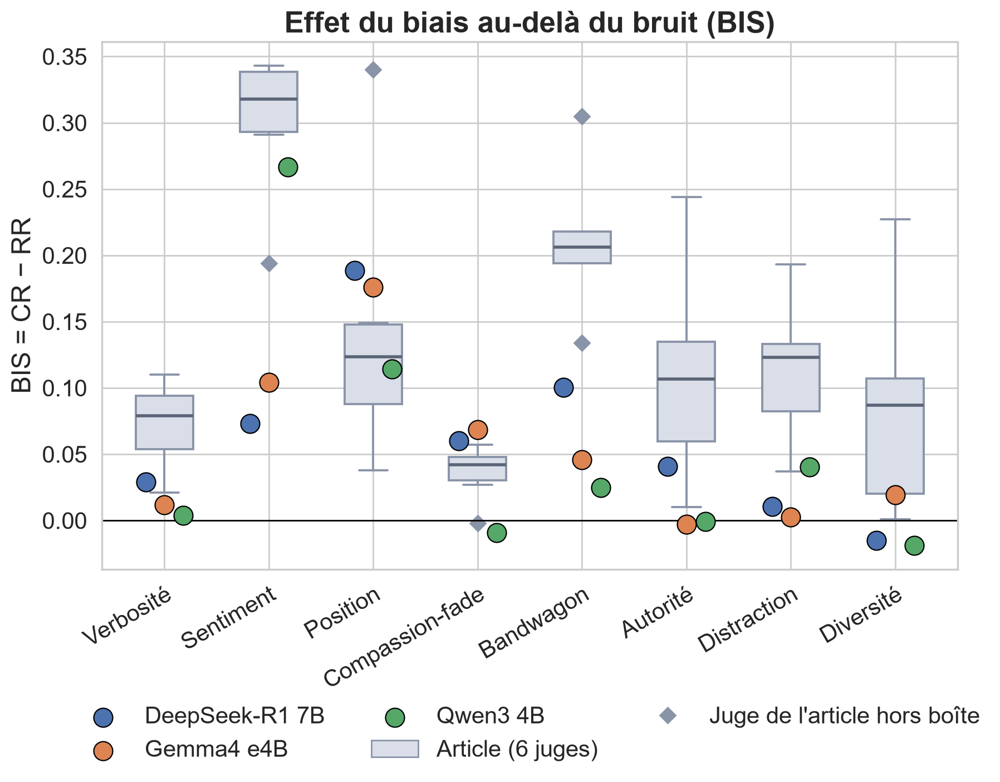

### Discours
L'écart entre cohérence et robustesse retire le bruit de la baisse de robustesse. C'est sans doute le graphique le plus important. 2 biais ressortent nettement chez nous : la position, la plus forte pour DeepSeek et Gemma, et le sentiment, le plus fort pour Qwen. Le bandwagon et le compassion-fade laissent un effet plus faible. En revanche, pour l'autorité, la distraction, la diversité et la verbosité, l'effet disparaît une fois le bruit retiré, alors que l'article en trouve un. Toutefois, il faut bien préciser que l'article utilise un seul taux de cohérence par famille de données, très élevé, ce qui gonfle mécaniquement son écart ; nous en utilisons un par biais.

---

## Diapositive 20 — Question 3 : biais par biais

### Texte
| Biais | Ce que dit l'article | Reproduit ? |
|---|---|---|
| Position | Biais net | **Oui**, encore plus fort : préférence pour A |
| Sentiment | Les tons émotionnels sont pénalisés | **Oui** |
| Self-enhancement | Les juges se surévaluent | **Oui**, plus fort pour DeepSeek-R1 |
| Verbosité | Juges robustes | **Oui** (Gemma4, Qwen3) |
| Bandwagon | Biais net, le pourcentage ne compte pas | **En partie** : biais plus faible, le pourcentage compte |
| Compassion-fade | Effet faible | **En partie** : effet de marque chez Gemma4 et Qwen3 |
| Raffinement | Effet faible | **En partie** : oui pour Qwen3, plus fort ailleurs |
| Autorité | Les fausses sources trompent | **Non** : elles sont plutôt soupçonnées |
| Distraction | Sensible, surtout sur la réponse correcte | **Non** : aucun effet au-delà du bruit |
| Diversité | Sensible (femmes, réfugiés) | **Non** : aucun effet au-delà du bruit |
| CoT | Le CoT améliore la précision | **Non** : gain nul ou négatif |
| Fallacy-oversight | Les juges détectent les failles | **Non comparable** : métrique contradictoire |

### Visuels
Aucun (tableau pleine largeur, colonne « Reproduit ? » colorée : vert, orange, rouge, gris).

### Discours
Répondons maintenant à la troisième question: les résultats tiennent-ils avec les modèles récents. 4 conclusions de l'article se reproduisent : la position, le sentiment, le self-enhancement et la verbosité. 3 se reproduisent en partie : le bandwagon, le compassion-fade et le raffinement, avec des intensités différentes. 4 ne se reproduisent pas : l'autorité, la distraction et la diversité n'ont pas d'effet au-delà du bruit, et le chain-of-thought n'apporte pas de gain. Enfin, le fallacy-oversight ne peut pas être comparé, à cause de sa métrique.

---

## Diapositive 21 — Ce qu'il faut retenir

### Texte
**Réponse : en partie.**

1. **Ce qui tient** : les biais les plus forts de l'article (position, sentiment, self-enhancement) se retrouvent avec des modèles récents et petits.
2. **Ce qui ne tient pas** : une fois le bruit retiré, plusieurs biais disparaissent (autorité, distraction, diversité), et le gain du CoT aussi.
3. **Pourquoi** :
   - nos juges sont plus petits et plus bruités ;
   - l'article compare la robustesse à une cohérence globale très élevée, ce qui gonfle ses effets ;
   - sa métrique ne dit pas dans quel sens va l'effet (autorité).

### Visuels
Aucun (trois cartes : « Ce qui tient », « Ce qui ne tient pas », « Pourquoi »).

### Discours
Notre réponse à la question est donc : en partie. Ce qui tient, ce sont les biais les plus forts : la position, le sentiment et le self-enhancement se retrouvent même avec des modèles de 4 à 7 milliards de paramètres. Ce qui ne tient pas, ce sont plusieurs effets plus faibles, qui disparaissent quand on retire le bruit, ainsi que le gain du chain-of-thought. Pourquoi ? D'abord parce que nos juges sont plus petits et plus bruités. Ensuite parce que l'article compare la robustesse à une cohérence globale très élevée, ce qui gonfle ses effets. Enfin parce que sa métrique ne dit pas si un changement va dans le bon ou le mauvais sens.

---

## Diapositive 22 — Question 4 : limites du benchmark

### Texte
**Conception**
- **Réponse correcte toujours en position A** : le biais de position contamine toutes les mesures.
- **Perturbations seulement sur la réponse correcte** : diversité (identité donnée à A uniquement : seule une discrimination est mesurable, pas un favoritisme) et fallacy (seule la réponse de référence est réécrite).
- **« Compassion fade » mal nommé** : en psychologie, c'est la baisse de compassion quand le nombre de victimes augmente ; ici, c'est un effet de marque.
- **Le prompt demande déjà d'éviter** les biais testés (position, longueur, noms).
- **Vérité terrain fragile** (étiquettes de préférence bruitées) et **une seule exécution**, sans test statistique.

**Incohérences de l'article**
- **Données** : tailles annoncées ≠ publiées (500 contre 150) ; jeu de données utilisé contradictoire (CoT, autorité).
- **Prompts** : description ≠ gabarits publiés (position des phrases ajoutées, prompt CoT, référence absente).
- **Métriques** : fallacy contradictoire, Err_SE ambigu.
- **Rédaction** : légendes erronées, abréviations jamais définies.

### Visuels
Aucun.

### Discours
Dernière question : le benchmark a-t-il des limites ? Oui. D'abord sa conception : la réponse correcte est toujours en position A, alors que c'est justement le biais le plus fort. Certaines perturbations ne touchent que la réponse correcte : l'identité de la diversité n'est attribuée qu'à A, si bien qu'on peut mesurer une discrimination, mais jamais un favoritisme. Le compassion-fade est mal nommé, le prompt demande déjà au juge d'éviter les biais testés, et tout repose sur une seule exécution. Ensuite, l'article contient de nombreuses incohérences, que je regroupe en 4 familles : les données, les prompts, les métriques et la rédaction. Prises une à une, elles sont mineures ; ensemble, elles empêchent de reproduire l'article à partir du seul texte. Tester un benchmark corrigé reste à faire.

---

## Diapositive 23 — Conclusion et perspectives

### Texte
**Réponses aux questions**
1. **Mêmes modèles** : impossible (modèles retirés, coût). Mêmes données et prompts, autres modèles.
2. **Stabilité** : bonne sur les questions factuelles ; sur les préférences, il faut retirer le bruit (BIS).
3. **Modèles récents** : en partie. Les biais forts tiennent, plusieurs effets faibles disparaissent.
4. **Benchmark** : des limites réelles de conception et de nombreuses incohérences.

**Perspectives**
- D'autres jeux de données : MT-Bench (jugements humains), RewardBench, JudgeBench.
- Un benchmark corrigé : positions alternées, perturbations dans les deux sens, métrique juste pour fallacy.
- Plusieurs exécutions, intervalles de confiance, tests statistiques.
- Des juges plus grands.

### Visuels
Deux colonnes : « Ce que nous retenons » et « Et ensuite ».

### Discours
Pour conclure. Reproduire l'article avec les mêmes modèles n'était pas possible ; nous avons gardé ses données et ses prompts avec 3 modèles récents et légers. Les jugements sont stables sur les questions factuelles, mais sur les préférences humaines, il faut retirer le bruit avant de parler de biais. Avec cette précaution, les biais forts de l'article se reproduisent, mais plusieurs effets faibles disparaissent. Enfin, le benchmark a de vraies faiblesses de conception. Pour la suite, nous proposons de tester d'autres jeux de données, de corriger le benchmark en alternant les positions et en perturbant les 2 réponses, de répéter les expériences, et d'utiliser des juges plus grands. Nous venons d'arriver à la fin de notre présentation,merci de votre attention.
